# vFurst — Managed Convention Management SaaS Platform

A full-featured convention/event management SaaS platform inspired by [ConCat](https://concat.app), built with **Next.js App Router** and **shadcn/ui-style local components**.

> [!NOTE]
> **Product Name**: "vFurst" (from the workspace name). This can be changed at any time.
> **Tagline**: "Manage your event, not a spreadsheet."

---

## Decisions (Resolved)

| Question | Decision |
|----------|----------|
| **Tenant model** | **Managed, invite-only B2B SaaS** — only a `PLATFORM_ADMIN` can provision, activate, suspend, or retire an organization. Creating a normal user account never creates a tenant or grants organizer access. |
| **Multi-tenancy** | **Shared platform with strict tenant isolation** — each organization is a tenant and owns events beneath it. Public portals use `{slug}.vfurst.reyuugames.com`; verified custom domains are activated by the platform in Phase 6. |
| **Application surfaces** | **Separated control plane and tenant plane** — `/platform/*` is the vFurst operator console, `/dashboard/*` is the membership-scoped organizer workspace, and organization subdomains/custom domains serve public attendee/vendor/volunteer flows. |
| **Account onboarding** | Public users may register for tickets, applications, and account history. The platform provisions an organization and emails a time-limited invitation to its initial owner; organization owners/admins may invite additional members into that organization only. |
| **UI theme** | **Light-only “Operational Calm”** — Geist typography, warm canvas, teal semantic accent, compact operational density, responsive layouts, reduced motion, and accessible local shadcn/Radix primitives. |
| **Mobile/event day** | **Responsive web/PWA surfaces** — check-in, cashier, express kiosk, and monitoring remain in the web app with scoped offline support. A separate React Native app is not part of the current phase plan. |
| **Email provider** | **Dual support**: AWS SES (production scale) + SMTP manual setup (self-hosted/dev). Configurable per-org. |

---

## Product and Access Model

vFurst is multi-tenant, but it is not a self-service workspace builder. Platform ownership, organization membership, and public participation are separate grants:

```text
vFurst platform
├── Platform administrators
│   ├── Provision and suspend organizations
│   ├── Assign the initial owner and activate domains
│   └── Operate payment providers, fees, reconciliation, payouts, and infrastructure
├── Organization tenant
│   ├── OWNER / ADMIN / MEMBER memberships
│   └── Events, registrations, commerce, staff, vendors, and event-day operations
└── Public users
    └── Registrations, orders, hotel bookings, volunteer applications, and vendor applications
```

### Non-negotiable authorization rules

- A `User` is only an identity. Self-registration grants no organization membership and no organizer-dashboard access.
- Only a `PLATFORM_ADMIN` may create an `Organization`, choose its platform subdomain, assign its initial owner, change platform payment configuration, activate a custom domain, or change tenant lifecycle status.
- An organization `OWNER` or `ADMIN` may create and operate events only inside organizations where that membership exists. They can never create another organization.
- Additional organizer access is granted through expiring, single-use organization invitations. Invitation acceptance creates the `OrgMember`; creating or upserting a bare user record does not grant access.
- Organizer queries only return memberships and resources accessible to the current user. There is no organizer-facing “all organizations” scope.
- Authorization is derived from the resource stored in the database. Server actions must not authorize a submitted `orgId` and then mutate an unrelated submitted resource ID.
- Cross-tenant reads and writes return a controlled not-found/forbidden result and must be covered by regression tests.
- Platform suspension stops new tenant activity without preventing signed payment callbacks, reconciliation, refunds, or other work needed to settle already-created orders safely.

### Surface and domain boundaries

| Surface | Canonical location | Audience | Responsibility |
|---------|--------------------|----------|----------------|
| Platform control plane | `/platform/*` on the central vFurst app domain | `PLATFORM_ADMIN` only | Tenant provisioning, lifecycle, domain activation, provider configuration, fees, payment exceptions, reconciliation, payouts, and support visibility |
| Organizer workspace | `/dashboard/*` on the central vFurst app domain | Authorized `OrgMember` users | Events, ticketing, store, hotel, vendors, volunteers, badges, check-in, reporting, and organization-scoped settings |
| Public tenant portal | `{orgSubdomain}.vfurst.reyuugames.com` or an activated custom domain | Attendees, vendors, volunteers, and public users | Event discovery, registration, checkout, store, hotel, and applications |
| Public account area | Central vFurst account/auth routes | Any authenticated user | Identity, orders, registrations, applications, and invitation acceptance; no organizer capabilities without membership |

Custom domains are public portal aliases by default. Organizer authentication remains on the central app domain so cookies, support, and authorization do not depend on customer-controlled DNS.

### Minimum role matrix

| Capability | Platform admin | Org owner | Org admin | Org member | Public user |
|------------|----------------|-----------|-----------|------------|-------------|
| Provision/suspend organization, activate domain | Yes | No | No | No | No |
| Configure global providers, fees, reconciliation, payouts | Yes | No | No | No | No |
| Manage organization identity, payout destination, owner transfer | Support/oversight | Yes | Limited | No | No |
| Invite organization members | Support/oversight | Yes | Admin/member only | No | No |
| Create and configure events | Only through explicit tenant support flow | Yes | Yes | No | No |
| Run allowed event operations | Only through explicit tenant support flow | Yes | Yes | Yes, for routes/actions explicitly permitted to `MEMBER` | No |
| Register, order, apply, view own public records | Yes | Yes | Yes | Yes | Yes |

Platform administration does not silently become an `OrgMember`. Support mutations inside a tenant must be explicit, tenant-scoped, and auditable; normal organizer actions continue to require membership.

---

## Revenue Model

Adopted from [convention_saas_roadmap.md](file:///D:/GitHub/vFurst/convention_saas_roadmap.md):

| Trigger | Fee |
|---------|-----|
| Per registered attendee | **$1.00** |
| Per hotel room booked | **$1.00** |
| Store / vendor transactions | **1%** |

USD card payments are processed via **Stripe Connect** using **destination charges**. Configured VND events can additionally offer an embedded **SePay VietQR**: funds arrive in vFurst's central account, exact whole-đồng transfers are matched by a unique payment memo, and organizer net proceeds are credited to a ledger for manual payout.

> [!IMPORTANT]
> **Stripe Connect charge type: Destination charges** (not direct charges or separate charges and transfers).
> - PaymentIntent created on vFurst's platform account
> - `transfer_data: { destination: convention_stripe_account_id }`
> - `application_fee_amount`: platform fee in cents ($1.00 = `100`, 1% = calculated)
> - vFurst owns the charge → can issue refunds, handle disputes
> - Convention receives funds minus fee automatically

> [!IMPORTANT]
> **Fee collection is single-path per provider**: Stripe collects the platform fee at checkout through `application_fee_amount`; SePay records the platform fee when the matched transfer credits organizer net proceeds to the internal ledger. There is **no secondary billing job** that invoices conventions separately. Reconciliation jobs audit and report; they never charge conventions again.

---

## Tech Stack

| Layer | Technology | Rationale |
|-------|-----------|-----------|
| **Monorepo** | Turborepo | Shared packages between the web app, worker, database, and email service |
| **Frontend** | Next.js 15 (App Router) | SSR, API routes, middleware, subdomain routing |
| **UI Library** | shadcn/ui-style local components (`apps/web/src/components/ui`) | Editable, accessible React primitives owned by the app |
| **Theme** | Operational Calm tokens in `apps/web/src/app/globals.css` | Light-only warm-canvas/teal system with responsive operational density and reduced-motion support |
| **Database** | PostgreSQL + Prisma ORM | Relational data, type-safe queries, row-level isolation, and bounded per-process connection pools |
| **Auth** | NextAuth.js v5 (Auth.js) | Multi-provider auth, session management, RBAC |
| **Payments** | Stripe Connect + SePay VietQR | Connected card settlement plus central VND receipt, reconciliation, organizer ledger, and manual payout/refund records |
| **File Storage** | AWS S3 (`@aws-sdk/client-s3`) | Badge templates, product images, event assets, vendor uploads. Uses presigned URLs for direct client-to-S3 uploads. |
| **Email** | AWS SES + SMTP (configurable) | Transactional emails, per-org provider choice |
| **Background Jobs / Shared Controls** | BullMQ + Redis | Email queues, badge generation, billing calculations, and atomic shared rate-limit counters |
| **Validation** | Zod + colocated TypeScript contracts | Validation stays with the owning action, API, payment, or package module |
| **State** | React Server Components + URL/form state | Server-first rendering with minimal client state |
| **Charts** | Recharts | Dashboard analytics visualization |
| **Barcode/QR** | `bwip-js` (generation) + `@zxing/browser` (scanning) | `bwip-js` generates barcode/QR images for badges. `@zxing/browser` decodes QR codes from device camera in check-in/express pages. |
| **Badge Rendering** | `pdf-lib` (PDF) + ZPL string gen (thermal) | Pure-JS server-side badge rendering. No native bindings, runs on Railway/Vercel without issues. `pdf-lib` for PDF output, custom ZPL string builder for Zebra thermal printers. |
| **Badge Designer** | `react-konva` | Canvas-based drag-and-drop badge template editor. Renders `BadgeTemplate.layout` elements on an HTML5 Canvas via React declarative API. |
| **Drag & Drop** | `@dnd-kit/core` + `@dnd-kit/sortable` | Accessible DnD for tier reordering (Phase 2), form builder field ordering (Phase 4), shift schedule assignment (Phase 4). |
| **Printing** | WebUSB API | Direct browser-to-Zebra thermal printer (Chrome/Edge only — see compat note in `webusb-printer.ts`) |
| **Real-time** | Server-Sent Events | Live check-in counters, dashboard updates |
| **Mobile** | Responsive web/PWA | Check-in, cashier, express kiosk, and monitoring without a separate native codebase |
| **CI/CD** | GitHub Actions | Lint, test, build, deploy pipeline |
| **Hosting** | Local Docker Compose for Phases 0–7; Vercel (web) + Railway (Redis/workers) at deployment time only | See "Local Development" below. Vercel/Railway aren't set up until the project deploys — every phase builds and verifies against local containers. |

---

## Local Development

> [!IMPORTANT]
> **Every phase (0 through 7) builds and verifies against this local stack. No cloud accounts — Vercel, Railway, real AWS — are needed until deployment, which happens as its own step after Phase 7.**

`docker-compose.yml` at the repo root runs four services:

| Service | Image | Replaces (in production) | Notes |
|---|---|---|---|
| `postgres` | `postgres:16` | Managed Postgres (e.g. Railway/Neon) | Runtime traffic uses `DATABASE_URL`; schema/backfill administration prefers `DIRECT_DATABASE_URL`. Prisma pools are bounded by `VFURST_DB_CONNECTION_LIMIT` and `VFURST_DB_POOL_TIMEOUT_SECONDS`. |
| `redis` | `redis:7` | Railway Redis | Used by BullMQ (`apps/worker`) and the web app's shared Lua-backed rate limits exactly as in production — no code difference |
| `minio` | `minio/minio` | AWS S3 | S3-API-compatible object storage. `apps/web/src/lib/s3.ts` must read `S3_ENDPOINT` from env — when set (e.g. `http://localhost:9000`), the AWS SDK v3 client points at MinIO instead of AWS; when unset, it defaults to real AWS S3. This is a config-only difference, not a code branch. |
| `mailpit` | `axllent/mailpit` | AWS SES | A local SMTP catcher with a web UI (`http://localhost:8025`) to view sent emails. Configure the dev org's email provider as SMTP pointing at `localhost:1025` — this uses the SMTP provider path that's already in the plan (`packages/email/src/providers/smtp.ts`), so no email-provider code is local-only special-cased. |

**Stripe** has no local emulator — use test mode and the Stripe CLI webhook forwarder. **SePay** is validated with its Sandbox, HMAC-signed webhooks, and API v2 reconciliation. Provider credentials and the checkout-token secret stay in environment variables; non-secret bank and fee settings live in the platform payment configuration.

**Migration path to cloud (post-Phase 7):** swapping to production infrastructure should be an environment-variable change, not a code change — `DATABASE_URL`, `REDIS_URL`, `S3_ENDPOINT` (removed to fall back to real AWS), and the org's email provider (switched from SMTP to SES) are the only things that differ. If a phase's implementation ever requires code branching on "are we local or cloud," that's a signal the abstraction is leaking and worth flagging in `PROGRESS.md` rather than working around silently.

---

## Database Connection Contract

`DATABASE_URL` is the runtime endpoint and may point at a PgBouncer-compatible pooler. `DIRECT_DATABASE_URL` must bypass transaction pooling for Prisma schema synchronization and administrative backfills. Every web/worker process applies the same positive `VFURST_DB_CONNECTION_LIMIT` and `VFURST_DB_POOL_TIMEOUT_SECONDS`; deployment readiness verifies `(VFURST_WEB_REPLICAS + VFURST_WORKER_REPLICAS) x VFURST_DB_CONNECTION_LIMIT <= VFURST_DB_CONNECTION_BUDGET`.

The launch-sized local default is six web replicas, one worker, and four Prisma connections per process (28 steady-state application connections). The application budget remains 80 against 97 usable local Postgres slots so rollout, administration, and reserved connections retain headroom. Cloud migration must configure both runtime and direct database URLs; it must not require a code branch.

---

## Data Model

```mermaid
erDiagram
    Organization ||--o{ Event : "hosts"
    Organization ||--o{ OrgMember : "has"
    Organization ||--o{ OrgInvitation : "invites"
    Organization ||--o{ StripeConnect : "connected"
    User ||--o{ OrgMember : "belongs to"
    User ||--o{ OrgInvitation : "sends"
    Event ||--o{ RegistrationType : "defines"
    Event ||--o{ Registration : "receives"
    Event ||--o{ Department : "has"
    Event ||--o{ VendorApplication : "receives"
    Event ||--o{ StoreProduct : "sells"
    Event ||--o{ Voucher : "offers"
    Event ||--o{ BadgeTemplate : "uses"
    Event ||--o{ Raffle : "runs"
    Event ||--o{ HotelBlock : "reserves"
    User ||--o{ Registration : "creates"
    User ||--o{ Cart : "owns"
    User ||--o{ AttendeeNote : "writes"
    User ||--o{ VolunteerApplication : "submits"
    RegistrationType ||--o{ AddOnDefinition : "offers"
    RegistrationType ||--o{ Registration : "categorizes"
    AddOnDefinition ||--o{ RegistrationAddOn : "instance of"
    Registration ||--o{ Badge : "generates"
    Registration ||--o{ OrderItem : "linked to"
    Registration ||--o{ RegistrationAddOn : "includes"
    Registration ||--o{ AttendeeNote : "has"
    User ||--o{ StaffAssignment : "works"
    Department ||--o{ StaffRole : "contains"
    Department ||--o{ VolunteerApplication : "applies to"
    StaffRole ||--o{ StaffAssignment : "fills"
    VolunteerApplication ||--o{ StaffAssignment : "accepted into"
    User ||--o{ VendorApplication : "submits"
    Cart ||--o{ CartItem : "contains"
    Order ||--o{ OrderItem : "contains"
    Order ||--o{ PaymentAttempt : "attempts"
    Order ||--o{ PaymentException : "may require review"
    Order ||--o{ OrganizerLedgerEntry : "credits organizer"
    Order ||--o| PaymentRefund : "may be refunded"
    User ||--o{ Order : "places"
    Voucher ||--o{ Order : "applied to"
    StoreProduct ||--o{ OrderItem : "sold as"
    BadgeTemplate ||--o{ Badge : "renders"
    HotelBlock ||--o{ HotelBooking : "fulfilled by"
    User ||--o{ HotelBooking : "books"
    Raffle ||--o{ RaffleEntry : "has"
    User ||--o{ RaffleEntry : "enters"
    Organization ||--o{ OrganizerLedgerEntry : "owns"
    Organization ||--o{ OrganizerPayout : "receives"
    OrganizerPayout ||--o{ OrganizerLedgerEntry : "settles"
    PaymentAttempt ||--o{ PaymentException : "may create"
```



### Product and tenant entities (29)

| Entity | Key Fields | Purpose |
|--------|-----------|---------|
| **User** | id, email, name, avatar, emailVerified, platformRole | Platform-wide identity for public participation and optional organization memberships; a normal account has no organizer privileges by default |
| **Organization** | id, name, slug, subdomain, status (PROVISIONING/ACTIVE/SUSPENDED/RETIRED), statusUpdatedBy/At, logo, contactEmail, requestedCustomDomain, customDomain, customDomainStatus, customDomainVerified/ActivatedBy/At, payoutBankCode, payoutAccountNumber, payoutAccountHolder | Platform-provisioned tenant, convention organizing body, and SePay payout destination; `customDomain` is only the active routed hostname, while requests/verification are staged separately; retirement is non-destructive |
| **OrgMember** | userId, orgId, role (OWNER/ADMIN/MEMBER) | Explicit tenant membership and role; this is the organizer-access grant |
| **StripeConnect** | orgId, stripeAccountId, onboardingComplete | Stripe Connect account link |
| **Event** | id, orgId, name, slug, startDate, endDate, venue, status, currency, settings | A convention with immutable USD/VND monetary context |
| **RegistrationType** | id, eventId, name, price, maxCapacity, scheduledPricing (JSON) | Attendance tiers (General, VIP, Sponsor) |
| **AddOnDefinition** | id, registrationTypeId, name, price, isComplimentary, maxQuantity, sortOrder | Defines an available add-on for a specific registration tier. Scoped to `RegistrationType` (not Event) so different tiers can offer different add-ons. `RegistrationAddOn` instances reference this. |
| **Registration** | id, eventId, userId, typeId, status, checkedInAt, badgeNumber, transferredFromId | An attendee's event registration |
| **RegistrationAddOn** | id, registrationId, addOnDefinitionId, price, quantity | An attendee's selected add-on. References `AddOnDefinition` for the catalog entry and `Registration` for the attendee. `price` is snapshotted at checkout time (in case the definition price changes later). |
| **Badge** | id, registrationId, templateId, barcodeData, nfcTag, printedAt | Physical/digital badge |
| **BadgeTemplate** | id, eventId, name, layout (JSON), dimensions | Badge design template |
| **Department** | id, eventId, name, leadUserId, formSchema (JSON) | Organizational department. `formSchema` stores the custom volunteer application form definition (field types, labels, required flags) built via the form builder UI. |
| **VolunteerApplication** | id, userId, departmentId, eventId, formResponses (JSON), availability (JSON), status (PENDING/APPROVED/REJECTED), reviewedBy, reviewedAt | Volunteer application with custom form data and approval workflow. Precedes StaffAssignment — approved applications become assignments. |
| **StaffRole** | id, departmentId, roleName, shifts (JSON), maxVolunteers | Staff position definitions |
| **StaffAssignment** | id, userId, roleId, volunteerApplicationId, shiftSlot, status | Volunteer shift assignment (links back to approved application) |
| **VendorApplication** | id, eventId, userId, businessName, status, boothAssignment, assistants (JSON) | Dealer booth application |
| **StoreProduct** | id, eventId, name, price, stock, images, category, surcharges | Merchandise for event store |
| **Cart** | id, userId, eventId, createdAt, updatedAt | Server-side shopping cart (DB-backed, survives device switches and avoids SSR hydration issues) |
| **CartItem** | id, cartId, itemType (REGISTRATION/ADDON/PRODUCT), refId, unitPrice, quantity | Line items in an active cart. Converted to OrderItems on checkout. Cleared after successful payment. |
| **Order** | id, userId, eventId, total, platformFee, currency, status, paymentProvider, paymentReference, checkout context, stripePaymentIntentId, voucherId | Provider-neutral payment, reservation, and fee record |
| **OrderItem** | id, orderId, itemType, refId, unitPrice, quantity | Line items in a completed order |
| **Voucher** | id, eventId, code, discountType, discountValue, maxUses, usedCount, expiresAt | Promo codes / comped registrations |
| **HotelBlock** | id, eventId, hotelName, roomTypes (JSON), cutoffDate | Hotel room block |
| **HotelBooking** | id, userId, blockId, roomType, checkIn, checkOut, confirmationCode | Hotel room booking |
| **Raffle** | id, eventId, name, prizes (JSON), drawDate | Event raffle/lottery |
| **RaffleEntry** | id, raffleId, userId, entryMethod (AUTO/MANUAL/PURCHASED), createdAt | Individual raffle entry. Prevents duplicates via unique(raffleId, userId) constraint. Used for random draw selection. |
| **AttendeeNote** | id, registrationId, authorId (→ User), content, createdAt | Internal staff notes. `authorId` is a foreign key to User (the staff member writing the note). |
| **ApiKey** | id, orgId, name, keyHash, scopes, lastUsedAt | Public API authentication |
| **WebhookEndpoint** | id, orgId, url, events, secret, active | Outbound webhook config |

### Infrastructure, access, and payment operations (13)

These models supplement the original 29 product/tenant entities. The managed-provisioning schema contains **42 models** in total, including the implemented `OrgInvitation`; `PROGRESS.md` and the actual Prisma schema remain the ground truth for implementation status.

| Entity | Purpose |
|---|---|
| **Account**, **Session**, **VerificationToken**, **Authenticator** | Auth.js persistence and provider/session infrastructure |
| **OrgInvitation** | Expiring, single-use invitation with organization, normalized email, requested role, token hash, inviter, acceptance, and revocation state; acceptance creates the membership |
| **PaymentProviderConfig** | Platform-admin Stripe/SePay enablement plus non-secret provider settings |
| **PaymentAttempt** | Provider, amount, currency, unique SePay memo/reference, lifecycle, expiry, and a schema-backed single-active-attempt lock for an order |
| **SePayWebhookEvent** | Raw webhook deduplication and processing record |
| **SePayReconciliationCursor** | API v2 incremental reconciliation position |
| **PaymentException** | Manual review for unknown, late, stale-attempt, underpaid, overpaid, account-mismatched, or invalid provider payments |
| **OrganizerLedgerEntry** | Idempotent organizer credit, refund, and adjustment entries for centrally received VND funds |
| **OrganizerPayout** | Recorded external organizer settlement and bank reference |
| **PaymentRefund** | Provider-aware manual refund record tied to idempotent fulfillment reversal |

---

## JSON Field Contracts

Several entities use JSON fields. To prevent ambiguity, their schemas are defined here:

| Entity.Field | JSON Schema | Example |
|-------------|-------------|----------|
| **RegistrationType.scheduledPricing** | `Array<{ startDate: ISO8601, endDate: ISO8601, price: number }>` | `[{ startDate: "2026-01-01", endDate: "2026-03-31", price: 4500 }, { startDate: "2026-04-01", endDate: "2026-06-30", price: 6000 }]` (prices in cents) |
| **Department.formSchema** | `Array<{ id: string, type: "text"\|"select"\|"checkbox"\|"textarea", label: string, required: boolean, options?: string[] }>` | `[{ id: "exp", type: "select", label: "Experience level", required: true, options: ["New", "1-2 cons", "3+"] }]` |
| **VolunteerApplication.formResponses** | `Record<string, string \| string[] \| boolean>` — keys match `formSchema[].id` | `{ "exp": "3+", "hasRadio": true }` |
| **VolunteerApplication.availability** | `Array<{ date: ISO8601, slots: string[] }>` | `[{ date: "2026-07-10", slots: ["morning", "afternoon"] }]` |
| **StaffRole.shifts** | `Array<{ date: ISO8601, startTime: HH:mm, endTime: HH:mm, label: string }>` | `[{ date: "2026-07-10", startTime: "09:00", endTime: "13:00", label: "Morning" }]` |
| **BadgeTemplate.layout** | `{ width: number, height: number, elements: Array<{ type: "text"\|"image"\|"barcode"\|"qr", x: number, y: number, w: number, h: number, field?: string, value?: string }> }` | Canvas layout definition |
| **HotelBlock.roomTypes** | `Array<{ name: string, rate: number, totalRooms: number, bookedRooms: number }>` | `[{ name: "Double", rate: 15900, totalRooms: 50, bookedRooms: 12 }]` (rate in cents) |
| **Raffle.prizes** | `Array<{ name: string, description: string, quantity: number }>` | `[{ name: "VIP Pass", description: "Free upgrade", quantity: 3 }]` |
| **VendorApplication.assistants** | `Array<{ name: string, email: string }>` | `[{ name: "Jane Doe", email: "jane@example.com" }]` |
| **StoreProduct.surcharges** | `Array<{ name: string, amount: number }>` | `[{ name: "Shipping", amount: 500 }]` (in cents) |
| **Event.settings** | `{ requireApproval: boolean, allowTransfers: boolean, maxRegistrationsPerUser: number, emailProviderId?: string, branding?: { logoUrl?: string, coverImageUrl?: string, accentColor?: "#RRGGBB" } }` | Event-level configuration flags and constrained public-portal branding. |

> [!NOTE]
> Monetary values are integers in their currency's minor unit: USD uses cents and VND uses whole đồng. The owning Event and Order carry an immutable currency so values are never interpreted without currency context. Zod and TypeScript contracts are colocated with their owning actions and libraries rather than kept in empty shared-package stubs.

---

## Project Structure (Monorepo — High-Level)

> [!IMPORTANT]
> **This is a directory overview only, not a scaffolding guide.** Do NOT pre-create all files in Phase 0. Each phase's `[NEW]` file tags are the authoritative source for what gets created and when. This overview exists for orientation — to understand where code lives, not what files exist.

```
d:\GitHub\vFurst\
├── turbo.json                         # Turborepo workspace config
├── package.json                       # Root workspace (apps/*, packages/*)
├── .github/workflows/                 # CI/CD pipelines
├── docs/                              # Plan, API contracts, launch audits/runbooks
├── packages/
│   ├── db/                            # Prisma schema + client singleton
│   └── email/                         # Email service abstraction (SES + SMTP)
├── apps/
│   ├── web/                           # Next.js 15 frontend + API
│   │   ├── middleware.ts              # Subdomain routing
│   │   ├── next.config.ts             # Sentry + scoped @serwist/next compilation
│   │   ├── public/                    # Static assets + compiled SW (sw.js)
│   │   └── src/
│   │       ├── app/                   # Next.js App Router pages
│   │       │   ├── (auth)/            # Login, public-account registration, invitation acceptance
│   │       │   ├── (marketing)/       # Landing, pricing, features, legal
│   │       │   ├── (convention)/[orgSlug]/ # Public tenant portal
│   │       │   ├── checkout/[orderId]/ # Shared Stripe/SePay checkout
│   │       │   ├── dashboard/         # Membership-scoped organizer operations
│   │       │   ├── platform/          # Platform-admin control plane
│   │       │   ├── docs/              # Embedded product/API docs
│   │       │   └── api/               # Auth, v1, payment status, webhooks
│   │       ├── components/            # UI, organizer shell, portal, marketing
│   │       ├── hooks/                 # Scoped service-worker registration
│   │       ├── lib/                   # Auth, tenant, payment, domain logic
│   │       ├── actions/               # Authenticated Server Actions
│   │       └── sw/                    # Service Worker source (compiled → public/sw.js)
│   └── worker/                        # BullMQ background job processor
│       └── src/jobs/                  # Email, badge, webhook, fee/SePay jobs
├── scripts/                           # E2E, load, readiness, platform-admin tools
└── tests/                             # Playwright, visual, accessibility, k6
```

> [!NOTE]
> **Why no full file tree?** A detailed file tree always drifts from the phase descriptions as the plan evolves. Files listed in the tree but not described in any phase cause the coding agent to generate empty/wrong stubs. Files described in phases but missing from the tree get skipped. The `[NEW]` tags in each phase section are the single source of truth.

---

## Key shadcn/ui Components by Feature Area

| Feature Area | Local shadcn/ui Components |
|-------------|----------------------------|
| **Organizer Shell** | Membership-scoped org/event switchers, breadcrumbs, collapsible rail, mobile drawer, user menu, and command menu; never exposes tenant creation or an all-tenant scope |
| **Platform Shell** | Separate platform-admin navigation for tenant provisioning/lifecycle, domains, provider configuration, reconciliation, exceptions, payouts, and support visibility |
| **Data Tables** | `Table`, `PowerSearch`, `Badge` |
| **Forms** | `FormLayout`, `TextInput`, native inputs/selects/textareas styled by tokens |
| **Cards & Stats** | `Card`, `ProgressBar`, semantic headings/text |
| **Overlays** | Radix-backed dropdown, tooltip, tabs, command dialog, and alert primitives |
| **Navigation** | Grouped event links, event-section tabs, breadcrumbs, `SegmentedControl`, and button links |
| **Feedback** | `Badge`, `Alert`, `EmptyState`, and consistent loading/error/status treatments |
| **Buttons/Actions** | `Button`, `buttonVariants` |
| **Layout** | Operational Calm `vf-*` layout classes, warm canvas, responsive density, 44 px mobile targets, reduced motion |
| **Content** | Native semantic HTML plus local UI primitives |
| **Check-in/Kiosk** | Focus layouts, online/offline status, native controls, local buttons/cards, scoped service-worker registration |
