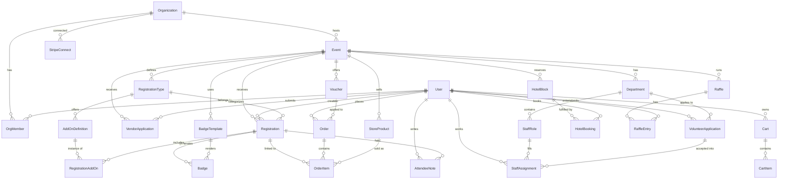

# vFurst — Convention Management SaaS Platform

A full-featured convention/event management SaaS platform inspired by [ConCat](https://concat.app), built with **Next.js App Router** and **shadcn/ui-style local components**.

> [!NOTE]
> **Product Name**: "vFurst" (from the workspace name). This can be changed at any time.
> **Tagline**: "Manage your event, not a spreadsheet."

---

## Decisions (Resolved)

| Question | Decision |
|----------|----------|
| **Multi-tenancy** | **Subdomain-based** — each org gets `{slug}.vfurst.app`. Custom domains (CNAME) added in Phase 6. |
| **UI theme** | **shadcn/ui CSS-variable tokens** — clean, professional, muted SaaS aesthetic. |
| **Mobile app** | **React Native companion app** — planned for Phase 5+, covering ticket scanning, check-in, and sales monitoring. |
| **Email provider** | **Dual support**: AWS SES (production scale) + SMTP manual setup (self-hosted/dev). Configurable per-org. |

---

## Revenue Model

Adopted from [convention_saas_roadmap.md](file:///D:/GitHub/vFurst/convention_saas_roadmap.md):

| Trigger | Fee |
|---------|-----|
| Per registered attendee | **$1.00** |
| Per hotel room booked | **$1.00** |
| Store / vendor transactions | **1%** |

Payments processed via **Stripe Connect** using **destination charges** — the PaymentIntent is created on the vFurst platform account with `transfer_data.destination` set to the convention's connected Stripe account. This gives vFurst control of the charge (refunds, disputes) while funds are automatically transferred to the convention minus the platform fee.

> [!IMPORTANT]
> **Stripe Connect charge type: Destination charges** (not direct charges or separate charges and transfers).
> - PaymentIntent created on vFurst's platform account
> - `transfer_data: { destination: convention_stripe_account_id }`
> - `application_fee_amount`: platform fee in cents ($1.00 = `100`, 1% = calculated)
> - vFurst owns the charge → can issue refunds, handle disputes
> - Convention receives funds minus fee automatically

> [!IMPORTANT]
> **Fee collection is single-path**: all platform fees are collected at checkout time via `application_fee_amount`. There is **no secondary billing job** that invoices conventions separately. The Phase 6 `reconcile-fees.ts` job is **read-only** — it audits that fees were collected correctly, generates usage reports for the billing dashboard, and flags discrepancies, but never charges conventions again.

---

## Phase Comparison: Your Roadmap vs. This Plan

Your [convention_saas_roadmap.md](file:///D:/GitHub/vFurst/convention_saas_roadmap.md) is the authoritative guide. This plan provides the **technical implementation details** for each of your phases.

| Your Phase | Your Focus | What This Plan Adds |
|------------|-----------|-------------------|
| **Phase 0** (Wk 1–3) | Foundation & Planning | Detailed project structure, Prisma schema design, CI/CD config, shadcn/ui setup, subdomain routing architecture |
| **Phase 1** (Wk 4–9) | Core Infrastructure | File-by-file breakdown of auth, RBAC, dashboard shell, Stripe Connect onboarding, email service abstraction layer |
| **Phase 2** (Wk 10–15) | Attendee Registration | Component specs for registration flow, scheduled pricing engine design, Stripe webhook handlers, order model |
| **Phase 3** (Wk 16–19) | Event Store & Add-ons | Unified cart architecture, discount code engine, refund flow via Stripe, inventory management |
| **Phase 4** (Wk 20–25) | Volunteers & Vendors | Volunteer form builder, department hierarchy, shift scheduling UI, dealer approval pipeline, booth management |
| **Phase 5** (Wk 26–30) | Advanced Features | Badge designer canvas architecture, WebUSB printing, express mode, offline fallback (Service Worker), raffle system |
| **Phase 6** (Wk 31–34) | SaaS Layer | Per-attendee billing implementation, usage dashboard, CNAME custom domains, public REST API + webhooks, docs site |
| **Phase 7** (Wk 35–37) | Launch | Beta program playbook, security audit checklist, marketing site, Playwright E2E test suite |

### Key Items Your Roadmap Has That My v1 Was Missing

> [!IMPORTANT]
> These are now fully incorporated:

- ✅ **Revenue model** — per-attendee + per-booking + 1% transaction fees
- ✅ **Stripe Connect** (not just Stripe) — convention orgs get their own Stripe accounts
- ✅ **Phase 6: SaaS Layer** — billing, API keys, webhooks, custom domains, docs site
- ✅ **Phase 7: Launch** — beta program, security audit, load testing, marketing site
- ✅ **Monorepo** — Turborepo for frontend + shared packages
- ✅ **BullMQ + Redis** — background jobs for emails, badge generation, billing
- ✅ **Registration transfers** — attendee-to-attendee transfer flow
- ✅ **Raffle system** — event-based raffle/lottery
- ✅ **Offline fallback** — Service Worker for check-in without connectivity
- ✅ **Custom email template engine** — per-convention customizable templates
- ✅ **User/staff notes** — internal notes on attendee records
- ✅ **Cashier UI** — dedicated in-person registration desk interface
- ✅ **Hotel room booking integration** — with $1.00 per-booking fee
- ✅ **Custom domain (CNAME)** — conventions use their own domain

### Key Items This Plan Has That Your Roadmap Could Benefit From

- 🆕 **shadcn/ui component mapping** — specific UI components for each feature
- 🆕 **File-by-file project structure** — exact file paths and responsibilities
- 🆕 **Data model (ER diagram)** — 29 entities with all relations
- 🆕 **Verification plan** — automated + manual test strategy per phase
- 🆕 **React Native companion app** — mobile scanning/monitoring

---

## Tech Stack

| Layer | Technology | Rationale |
|-------|-----------|-----------|
| **Monorepo** | Turborepo | Shared packages between web, API, mobile |
| **Frontend** | Next.js 15 (App Router) | SSR, API routes, middleware, subdomain routing |
| **UI Library** | shadcn/ui-style local components (`apps/web/src/components/ui`) | editable, accessible React primitives owned by the app |
| **Theme** | shadcn/ui CSS-variable tokens | Clean, professional SaaS aesthetic with dark mode |
| **Database** | PostgreSQL + Prisma ORM | Relational data, type-safe queries, row-level isolation |
| **Auth** | NextAuth.js v5 (Auth.js) | Multi-provider auth, session management, RBAC |
| **Payments** | Stripe Connect | Convention Stripe onboarding, `application_fee_amount` |
| **File Storage** | AWS S3 (`@aws-sdk/client-s3`) | Badge templates, product images, event assets, vendor uploads. Uses presigned URLs for direct client-to-S3 uploads. |
| **Email** | AWS SES + SMTP (configurable) | Transactional emails, per-org provider choice |
| **Background Jobs** | BullMQ + Redis | Email queues, badge generation, billing calculations |
| **Validation** | Zod | Schema validation for forms and API |
| **State** | React Server Components + `nuqs` | URL state for filters/search, minimal client state |
| **Charts** | Recharts | Dashboard analytics visualization |
| **Barcode/QR** | `bwip-js` (generation) + `@zxing/browser` (scanning) | `bwip-js` generates barcode/QR images for badges. `@zxing/browser` decodes QR codes from device camera in check-in/express pages. |
| **Badge Rendering** | `pdf-lib` (PDF) + ZPL string gen (thermal) | Pure-JS server-side badge rendering. No native bindings, runs on Railway/Vercel without issues. `pdf-lib` for PDF output, custom ZPL string builder for Zebra thermal printers. |
| **Badge Designer** | `react-konva` | Canvas-based drag-and-drop badge template editor. Renders `BadgeTemplate.layout` elements on an HTML5 Canvas via React declarative API. |
| **Drag & Drop** | `@dnd-kit/core` + `@dnd-kit/sortable` | Accessible DnD for tier reordering (Phase 2), form builder field ordering (Phase 4), shift schedule assignment (Phase 4). |
| **Printing** | WebUSB API | Direct browser-to-Zebra thermal printer (Chrome/Edge only — see compat note in `webusb-printer.ts`) |
| **Real-time** | Server-Sent Events | Live check-in counters, dashboard updates |
| **Mobile** | React Native (Expo) | Companion app for scanning + monitoring |
| **CI/CD** | GitHub Actions | Lint, test, build, deploy pipeline |
| **Hosting** | Vercel (web) + Railway (Redis/workers) | Optimized Next.js hosting + background job infra |

---

## Data Model



### Core Entities (29)

| Entity | Key Fields | Purpose |
|--------|-----------|---------|
| **User** | id, email, name, avatar, emailVerified | Platform-wide user account |
| **Organization** | id, name, slug, subdomain, logo, contactEmail, customDomain | Convention organizing body |
| **OrgMember** | userId, orgId, role (OWNER/ADMIN/MEMBER) | Org membership + role |
| **StripeConnect** | orgId, stripeAccountId, onboardingComplete | Stripe Connect account link |
| **Event** | id, orgId, name, slug, startDate, endDate, venue, status, settings | A specific convention instance |
| **RegistrationType** | id, eventId, name, price, maxCapacity, scheduledPricing (JSON) | Attendance tiers (General, VIP, Sponsor) |
| **AddOnDefinition** | id, registrationTypeId, name, price, isComplimentary, maxQuantity, sortOrder | Defines an available add-on for a specific registration tier. Scoped to `RegistrationType` (not Event) so different tiers can offer different add-ons. `RegistrationAddOn` instances reference this. |
| **Registration** | id, eventId, userId, typeId, status, checkedInAt, badgeNumber, transferredFromId | An attendee's event registration |
| **RegistrationAddOn** | id, registrationId, addOnDefinitionId, price, quantity | An attendee's selected add-on. References `AddOnDefinition` for the catalog entry and `Registration` for the attendee. `price` is snapshotted at checkout time (in case the definition price changes later). |
| **Badge** | id, registrationId, templateId, barcodeData, nfcTag, printedAt | Physical/digital badge |
| **BadgeTemplate** | id, eventId, name, layout (JSON), dimensions | Badge design template |
| **Department** | id, eventId, name, leadUserId, formSchema (JSON) | Organizational department. `formSchema` stores the custom volunteer application form definition (field types, labels, required flags) built via the form builder UI. |
| **VolunteerApplication** | id, userId, departmentId, eventId, formResponses (JSON), availability (JSON), status (PENDING/APPROVED/REJECTED), reviewedBy, reviewedAt | Volunteer application with custom form data and approval workflow. Precedes StaffAssignment — approved applications become assignments. |
| **StaffRole** | id, departmentId, roleName, shifts (JSON), maxVolunteers | Staff position definitions |
| **StaffAssignment** | id, userId, roleId, volunteerApplicationId, shiftSlot, status | Volunteer shift assignment (links back to approved application) |
| **VendorApplication** | id, eventId, userId, businessName, status, boothAssignment, assistants (JSON) | Dealer booth application |
| **StoreProduct** | id, eventId, name, price, stock, images, category, surcharges | Merchandise for event store |
| **Cart** | id, userId, eventId, createdAt, updatedAt | Server-side shopping cart (DB-backed, survives device switches and avoids SSR hydration issues) |
| **CartItem** | id, cartId, itemType (REGISTRATION/ADDON/PRODUCT), refId, unitPrice, quantity | Line items in an active cart. Converted to OrderItems on checkout. Cleared after successful payment. |
| **Order** | id, userId, eventId, total, platformFee, status, stripePaymentIntentId, voucherId | Payment + fee record |
| **OrderItem** | id, orderId, itemType, refId, unitPrice, quantity | Line items in a completed order |
| **Voucher** | id, eventId, code, discountType, discountValue, maxUses, usedCount, expiresAt | Promo codes / comped registrations |
| **HotelBlock** | id, eventId, hotelName, roomTypes (JSON), cutoffDate | Hotel room block |
| **HotelBooking** | id, userId, blockId, roomType, checkIn, checkOut, confirmationCode | Hotel room booking |
| **Raffle** | id, eventId, name, prizes (JSON), drawDate | Event raffle/lottery |
| **RaffleEntry** | id, raffleId, userId, entryMethod (AUTO/MANUAL/PURCHASED), createdAt | Individual raffle entry. Prevents duplicates via unique(raffleId, userId) constraint. Used for random draw selection. |
| **AttendeeNote** | id, registrationId, authorId (→ User), content, createdAt | Internal staff notes. `authorId` is a foreign key to User (the staff member writing the note). |
| **ApiKey** | id, orgId, name, keyHash, scopes, lastUsedAt | Public API authentication |
| **WebhookEndpoint** | id, orgId, url, events, secret, active | Outbound webhook config |

---

## JSON Field Contracts

Several entities use JSON fields. To prevent ambiguity, their schemas are defined here:

| Entity.Field | JSON Schema | Example |
|-------------|-------------|----------|
| **RegistrationType.scheduledPricing** | `Array<{ startDate: ISO8601, endDate: ISO8601, price: number }>` | `[{ startDate: "2026-01-01", endDate: "2026-03-31", price: 4500 }, { startDate: "2026-04-01", endDate: "2026-06-30", price: 6000 }]` (prices in cents) |
| **Department.formSchema** | `Array<{ id: string, type: "text"\|"select"\|"checkbox"\|"textarea", label: string, required: boolean, options?: string[] }>` | `[{ id: "exp", type: "select", label: "Experience level", required: true, options: ["New", "1-2 cons", "3+"] }]` |
| **VolunteerApplication.formResponses** | `Record<string, string \| string[] \| boolean>` — keys match `formSchema[].id` | `{ "exp": "3+", "hasRadio": true }` |
| **VolunteerApplication.availability** | `Array<{ date: ISO8601, slots: string[] }>` | `[{ date: "2026-07-10", slots: ["morning", "afternoon"] }]` |
| **StaffRole.shifts** | `Array<{ date: ISO8601, startTime: HH:mm, endTime: HH:mm, label: string }>` | `[{ date: "2026-07-10", startTime: "09:00", endTime: "13:00", label: "Morning" }]` |
| **BadgeTemplate.layout** | `{ width: number, height: number, elements: Array<{ type: "text"\|"image"\|"barcode"\|"qr", x: number, y: number, w: number, h: number, field?: string, value?: string }> }` | Canvas layout definition |
| **HotelBlock.roomTypes** | `Array<{ name: string, rate: number, totalRooms: number, bookedRooms: number }>` | `[{ name: "Double", rate: 15900, totalRooms: 50, bookedRooms: 12 }]` (rate in cents) |
| **Raffle.prizes** | `Array<{ name: string, description: string, quantity: number }>` | `[{ name: "VIP Pass", description: "Free upgrade", quantity: 3 }]` |
| **VendorApplication.assistants** | `Array<{ name: string, email: string }>` | `[{ name: "Jane Doe", email: "jane@example.com" }]` |
| **StoreProduct.surcharges** | `Array<{ name: string, amount: number }>` | `[{ name: "Shipping", amount: 500 }]` (in cents) |
| **Event.settings** | `{ requireApproval: boolean, allowTransfers: boolean, maxRegistrationsPerUser: number, emailProviderId?: string }` | Event-level configuration flags |

> [!NOTE]
> All monetary values in JSON fields use **cents** (integer) to avoid floating-point precision issues. The Zod validators in `packages/validators/` enforce these schemas at runtime.

---

## Project Structure (Monorepo — High-Level)

> [!IMPORTANT]
> **This is a directory overview only, not a scaffolding guide.** Do NOT pre-create all files in Phase 0. Each phase's `[NEW]` file tags are the authoritative source for what gets created and when. This overview exists for orientation — to understand where code lives, not what files exist.

```
d:\GitHub\vFurst\
├── turbo.json                         # Turborepo workspace config
├── package.json                       # Root workspace (apps/*, packages/*)
├── .github/workflows/                 # CI/CD pipelines
├── docs/                              # API contracts, OpenAPI specs
├── packages/
│   ├── db/                            # Prisma schema + client singleton
│   ├── email/                         # Email service abstraction (SES + SMTP)
│   ├── validators/                    # Shared Zod schemas
│   └── types/                         # Shared TypeScript types + enums
├── apps/
│   ├── web/                           # Next.js 15 frontend + API
│   │   ├── middleware.ts              # Subdomain routing
│   │   ├── next.config.ts             # Includes @serwist/next for SW compilation
│   │   ├── public/                    # Static assets + compiled SW (sw.js)
│   │   └── src/
│   │       ├── app/                   # Next.js App Router pages
│   │       │   ├── (auth)/            # Login, register
│   │       │   ├── (marketing)/       # Landing, pricing, features, legal
│   │       │   ├── (convention)/      # Convention subdomain pages (public)
│   │       │   ├── dashboard/         # Admin dashboard (local shell + sidebar)
│   │       │   └── api/               # API routes (auth, webhooks, v1 public)
│   │       ├── components/            # Reusable UI components
│   │       ├── hooks/                 # Client hooks (e.g., useServiceWorker)
│   │       ├── lib/                   # Utilities (auth, stripe, barcode, etc.)
│   │       ├── actions/               # Server Actions
│   │       └── sw/                    # Service Worker source (compiled → public/sw.js)
│   └── worker/                        # BullMQ background job processor
│       └── src/jobs/                  # Email, badge gen, fee reconciliation
```

> [!NOTE]
> **Why no full file tree?** A detailed file tree always drifts from the phase descriptions as the plan evolves. Files listed in the tree but not described in any phase cause the coding agent to generate empty/wrong stubs. Files described in phases but missing from the tree get skipped. The `[NEW]` tags in each phase section are the single source of truth.

---

## Phased Implementation (Aligned to Your Roadmap)

### Phase 0 — Foundation & Planning (Weeks 1–3)

> **Goal**: Monorepo scaffold, database schema, CI/CD, dev environment, and architectural decisions locked in.

| Task | Files / Actions |
|------|----------------|
| Define MVP feature scope | This document ✅ |
| Database schema design | [NEW] `packages/db/prisma/schema.prisma` — all 29 entities from the Core Entities table, enums, indexes, row-level tenant isolation via `orgId`. **This includes all entities** (ApiKey, WebhookEndpoint, etc.) even if their management UI is built in a later phase — the schema is defined once upfront. JSON fields must conform to the JSON Field Contracts section above. |
| API contract design | [NEW] `docs/api-contracts/` — OpenAPI spec for REST endpoints + webhook event schemas |
| Set up monorepo | [NEW] `turbo.json`, root `package.json` with workspaces: `apps/*`, `packages/*` |
| CI/CD pipeline | [NEW] `.github/workflows/ci.yml` — lint, type-check, test, build on PR |
| | [NEW] `.github/workflows/deploy.yml` — Vercel preview + production deploys |
| Dev / staging / prod envs | [NEW] `.env.example`, `.env.local`, `.env.staging` — env var templates |
| Stripe Connect setup | Create Stripe Connect platform account, configure OAuth redirect URIs |
| Choose and configure hosting | Vercel project creation, Railway Redis instance, AWS S3 bucket |
| Initialize Next.js + shadcn/ui | [NEW] `apps/web/` — Next.js 15 app with shadcn/ui imports in `globals.css` |
| | [NEW] `apps/web/src/app/layout.tsx` — Root layout with global CSS-token styling |
| | [NEW] `apps/web/src/components/providers.tsx` — Client providers wrapper |

---

### Phase 1 — Core Infrastructure (Weeks 4–9)

> **Goal**: Multi-tenant architecture, auth, RBAC, convention CRUD, Stripe Connect onboarding, dashboard shell, email service, and subdomain routing.

---

#### Multi-Tenancy & Subdomain Routing

##### [NEW] `apps/web/middleware.ts`
Next.js middleware for subdomain-based routing:
- Parse `{slug}.vfurst.app` from `Host` header
- Rewrite to `/(convention)` route group with org context
- Pass-through for `app.vfurst.app` (dashboard) and `vfurst.app` (marketing)
- Handle custom domains (Phase 6) via database lookup

##### [NEW] `apps/web/src/lib/subdomain.ts`
Subdomain resolution helpers:
- `resolveOrganization(hostname)` — lookup org by subdomain or custom domain
- `getConventionUrl(org)` — generate subdomain URL for an org

---

#### File Storage (S3)

##### [NEW] `apps/web/src/lib/s3.ts`
AWS S3 client and upload helpers using `@aws-sdk/client-s3` and `@aws-sdk/s3-request-presigner`:
- `s3Client` — singleton S3 client configured from env vars (`AWS_REGION`, `AWS_ACCESS_KEY_ID`, `AWS_SECRET_ACCESS_KEY`, `S3_BUCKET_NAME`)
- `getPresignedUploadUrl(key, contentType, maxSizeBytes)` — generates a presigned PUT URL for direct client-to-S3 uploads (avoids routing large files through the Next.js server)
- `getPublicUrl(key)` — returns the public URL for a stored object
- `deleteObject(key)` — deletes an object from S3
- `uploadFromBuffer(key, buffer, contentType)` — server-side upload for programmatic use (e.g., generated badge PDFs)
- Key structure: `{orgId}/{context}/{filename}` (e.g., `org_123/logos/logo.png`, `org_123/products/img_456.webp`, `org_123/vendor-files/license.pdf`)

> [!NOTE]
> This file is created in Phase 1 because org logo upload (`organizations/new` and `organizations/[orgId]/settings`) is the first feature requiring S3. Subsequent phases (Phase 3: product images, Phase 4: vendor file uploads, Phase 5: badge template images) all import from this same helper.

---

#### Auth & RBAC

##### [NEW] `apps/web/src/lib/auth.ts`
NextAuth v5 configuration:
- Credentials provider (email/password with bcrypt)
- Google OAuth provider
- Prisma adapter for session persistence
- Custom session callback to include `orgMemberships` with roles
- JWT strategy for API route authentication

##### [NEW] `apps/web/src/app/(auth)/login/page.tsx`
Login page using shadcn/ui `Card`, `TextInput`, `Button`, `FormLayout`, `Divider`.

##### [NEW] `apps/web/src/app/(auth)/register/page.tsx`
Registration page with email/password + OAuth buttons.

##### [NEW] `apps/web/src/app/(auth)/layout.tsx`
Centered auth layout — no AppShell, minimal branding.

---

#### Convention CRUD

##### [NEW] `apps/web/src/app/dashboard/organizations/page.tsx`
Org list using shadcn/ui `Table`, `EmptyState`, `Button`.

##### [NEW] `apps/web/src/app/dashboard/organizations/new/page.tsx`
Create org form: name, slug (auto-generated, editable), logo upload, contact email.

##### [NEW] `apps/web/src/app/dashboard/organizations/[orgId]/page.tsx`
Org overview: member list, events list, quick stats.

##### [NEW] `apps/web/src/app/dashboard/organizations/[orgId]/settings/page.tsx`
Org settings: name, logo, subdomain slug, email provider config (SES vs SMTP).

##### [NEW] `apps/web/src/app/dashboard/organizations/[orgId]/members/page.tsx`
Member management: invite by email, assign roles (OWNER/ADMIN/MEMBER), remove.

##### [NEW] `apps/web/src/app/dashboard/organizations/[orgId]/stripe-connect/page.tsx`
Stripe Connect onboarding:
- OAuth flow to connect convention's Stripe account
- Account status dashboard
- Test mode toggle

##### [NEW] `apps/web/src/actions/event-actions.ts`
Server Actions: `createEvent`, `updateEvent`, `publishEvent`, `archiveEvent`, `deleteEvent`.

---

#### Dashboard Shell

##### [NEW] `apps/web/src/app/dashboard/layout.tsx`
Dashboard layout using a local shadcn/ui-styled shell and sidebar:
```
├── Dashboard (home)
├── Organizations
├── Events
├── Settings
└── [User Avatar] Profile / Logout
```

##### [NEW] `apps/web/src/app/dashboard/page.tsx`
Dashboard home: recent events, quick stats (total attendees, revenue), quick action buttons.

##### [NEW] `apps/web/src/components/dashboard/app-shell.tsx`
Reusable dashboard shell wrapper with navigation state management.

##### [NEW] `apps/web/src/components/dashboard/stat-card.tsx`
Metric card component using shadcn/ui `Card`, `ProgressBar`, and semantic headings/text.

---

#### Email Service

##### [NEW] `packages/email/src/providers/ses.ts`
AWS SES email provider using `@aws-sdk/client-ses`.

##### [NEW] `packages/email/src/providers/smtp.ts`
Generic SMTP provider using `nodemailer` — for self-hosted/custom SMTP servers.

##### [NEW] `packages/email/src/index.ts`
Email service abstraction:
- Factory pattern: `createEmailProvider(config)` returns SES or SMTP instance
- Unified `sendEmail(to, template, data)` interface
- Per-org provider configuration stored in org settings

##### [NEW] `packages/email/src/templates/`
React Email templates: welcome, registration confirmation, password reset.

---

#### Background Worker Bootstrap

##### [NEW] `apps/worker/src/index.ts`
BullMQ worker entry point:
- Connects to Redis instance
- Registers job handlers for all queues
- Graceful shutdown on SIGTERM
- Health check endpoint

##### [NEW] `apps/worker/src/queues.ts`
Typed queue instances and shared queue configuration:
- `emailQueue` — transactional email delivery
- `badgeQueue` — batch badge generation
- `reconcileQueue` — nightly fee reconciliation
- Default job options (retry, backoff, timeout)

##### [NEW] `apps/worker/package.json`
Worker package config with `tsx` for dev mode and BullMQ + Redis dependencies.

##### [NEW] `apps/worker/src/jobs/send-email.ts`
BullMQ job processor for `emailQueue`:
- Dequeues email jobs and calls `sendEmail()` from `packages/email`
- Handles per-org provider resolution (SES vs SMTP based on org settings)
- Retry with exponential backoff on transient failures (network, rate limits)
- Dead-letter queue for permanently failed emails
- Logs delivery status for email template analytics

> [!NOTE]
> The worker is bootstrapped in Phase 1 because email delivery (the first background job) is needed immediately. Phase 5 adds `generate-badges.ts` and Phase 6 adds `reconcile-fees.ts` to the existing worker infrastructure.

---

### Phase 2 — Attendee Registration & Hotel Booking (Weeks 10–15)

> **Goal**: Product system, attendance tiers, scheduled pricing, public registration flow, Stripe payments, order management, tier upgrades, add-ons, confirmation emails, **and hotel room booking**.

---

##### [NEW] `apps/web/src/app/dashboard/events/page.tsx`
Events list with filters using shadcn/ui `PowerSearch`, `Table`, `Badge` for status.

##### [NEW] `apps/web/src/app/dashboard/events/new/page.tsx`
Event creation wizard (multi-step using shadcn/ui `SegmentedControl`):
1. Basic info (name, dates, venue, description)
2. Registration types + pricing tiers
3. Settings (payment, capacity, visibility)
4. Review & publish

##### [NEW] `apps/web/src/app/dashboard/events/[eventId]/layout.tsx`
Event-scoped layout with contextual sidebar:
```
├── Overview
├── Registrations
│   ├── All Registrations
│   ├── Registration Types
│   └── Transfers
├── Check-In
├── Badges
├── Staff
│   ├── Overview
│   ├── Departments
│   ├── Applications      ← VolunteerApplication management
│   └── Schedule
├── Vendors
├── Store
├── Hotel
├── Vouchers
├── Raffle
├── Analytics
└── Settings
```

##### [NEW] `apps/web/src/app/dashboard/events/[eventId]/page.tsx`
Event overview dashboard with Recharts:
- Registration count trend (area chart)
- Revenue summary (stat cards)
- Capacity by tier (progress bars)
- Recent registrations feed

##### [NEW] `apps/web/src/app/dashboard/events/[eventId]/registrations/types/page.tsx`
Registration type management:
- CRUD for attendance tiers
- **Scheduled pricing engine**: define price changes by date range (early bird → regular → late)
- Capacity limits per tier
- **Add-on definitions per tier**: CRUD for `AddOnDefinition` records scoped to each `RegistrationType` (name, price, isComplimentary, maxQuantity). Different tiers can offer different add-ons.
- Drag-to-reorder display order

##### [NEW] `apps/web/src/app/(convention)/register/page.tsx`
Public registration flow (on convention subdomain):
1. Select tier → shows scheduled price
2. Personal info form
3. Add-ons selection
4. Apply voucher/discount code
5. Stripe Checkout (via Stripe Connect, with `application_fee_amount: 100` = $1.00)
6. Confirmation page + email

##### [NEW] `apps/web/src/app/api/webhooks/stripe/route.ts`
Stripe webhook handler:
- `checkout.session.completed` → confirm registration, send confirmation email
- `payment_intent.succeeded` → mark order paid
- `charge.refunded` → update order + registration status

##### [NEW] `apps/web/src/app/dashboard/events/[eventId]/registrations/page.tsx`
Registrations table:
- Search/filter by name, email, status, type
- Bulk actions (confirm, cancel, refund)
- Export to CSV
- Click-through to detail

##### [NEW] `apps/web/src/app/dashboard/events/[eventId]/registrations/[regId]/page.tsx`
Registration detail:
- Attendee info, payment status, badge preview
- Check-in status, add-ons
- **Staff notes** (`AttendeeNote` CRUD)
- Actions: resend email, cancel, refund, upgrade tier
- **Registration transfer**: initiate transfer to another user

##### [NEW] `apps/web/src/actions/registration-actions.ts`
Server Actions: `createRegistration`, `confirmRegistration`, `cancelRegistration`, `refundRegistration`, `upgradeTier`, `transferRegistration`.

---

#### Hotel Booking (Phase 2)

> [!NOTE]
> Hotel booking is built here in Phase 2 (not deferred) because it shares the registration flow's Stripe Connect payment pipeline and the $1.00 `application_fee_amount` pattern. Building it alongside registration avoids duplicating payment logic later.

##### [NEW] `apps/web/src/app/dashboard/events/[eventId]/hotel/page.tsx`
Hotel management (admin):
- Create hotel blocks: hotel name, room types (single/double/suite), rates, block size, cutoff date
- View booking status per block (booked vs. available)
- Manage individual bookings (cancel, modify dates)

##### [NEW] `apps/web/src/app/(convention)/hotel/page.tsx`
Public hotel booking page (convention subdomain):
- Browse available hotel blocks and room types
- Select dates, room type
- Stripe Checkout with `application_fee_amount: 100` ($1.00 per booking)
- Confirmation email with booking details

##### [NEW] `apps/web/src/actions/hotel-actions.ts`
Server Actions: `createHotelBlock`, `updateHotelBlock`, `bookRoom`, `cancelBooking`.

---

### Phase 3 — Event Store & Add-ons (Weeks 16–19)

> **Goal**: Product catalog, inventory, surcharges, discount engine, vouchers/comps, unified cart, refunds.

---

##### [NEW] `apps/web/src/app/dashboard/events/[eventId]/store/page.tsx`
Product management:
- Product CRUD: name, price, description, images (S3 upload), stock, category
- **Surcharges**: configurable per-product surcharges (shipping, handling)
- Product add-ons (e.g., size selection, color)
- Inventory tracking with low-stock alerts

##### [NEW] `apps/web/src/app/(convention)/store/page.tsx`
Public storefront (convention subdomain):
- Product grid with shadcn/ui `Card`, image gallery
- **Unified cart**: combine registration + store items in one checkout
- Stripe Checkout with 1% `application_fee_amount`

##### [NEW] `apps/web/src/components/store/cart.tsx`
Shopping cart component:
- **Server-side cart** backed by `Cart` + `CartItem` database tables (not localStorage)
- Cart loaded via Server Component on page render — no SSR/hydration mismatch
- Mutations via Server Actions (`addToCart`, `removeFromCart`, `updateQuantity`)
- Works across devices (user logs in → same cart), survives incognito/storage clears
- Discount code application
- Real-time total calculation with surcharges
- Cart → Order conversion on successful Stripe Checkout (CartItems become OrderItems, cart is cleared)

> [!NOTE]
> **Why not localStorage?** Next.js App Router renders on the server first. A localStorage-based cart would render empty on the server, then hydrate with items on the client, causing a React hydration mismatch error. A DB-backed cart also enables cross-device persistence and unified cart features (registration + store in one checkout).

##### [NEW] `apps/web/src/app/dashboard/events/[eventId]/vouchers/page.tsx`
Voucher management:
- Create: percentage discount, flat discount, or **comped registration** (100% off)
- Usage limits, expiration dates, tier restrictions
- **Bulk generate**: create N codes with shared rules
- Usage tracking table

##### [NEW] `apps/web/src/app/dashboard/events/[eventId]/store/orders/page.tsx`
Order management:
- Order list with status filters
- Order detail with line items + platform fee breakdown
- **Refund flow**: full or partial refund via Stripe Connect

##### [NEW] `apps/web/src/actions/store-actions.ts`
Server Actions: `createProduct`, `updateProduct`, `deleteProduct`, `createOrder`, `refundOrder`, `partialRefund`.

##### [NEW] `apps/web/src/actions/voucher-actions.ts`
Server Actions: `createVoucher`, `bulkGenerateVouchers`, `validateVoucher`, `applyVoucher`.

##### [NEW] `apps/web/src/actions/cart-actions.ts`
Server Actions for the DB-backed shopping cart: `addToCart`, `removeFromCart`, `updateQuantity`, `clearCart`, `convertCartToOrder`.
Used by `components/store/cart.tsx` for all cart mutations.

---

### Phase 4 — Volunteers & Vendors (Weeks 20–25)

> **Goal**: Volunteer application builder, department management, approval workflows, dealer applications, booth/table management, assistants.

---

#### Volunteer System

##### [NEW] `apps/web/src/app/dashboard/events/[eventId]/staff/page.tsx`
Staff overview: department list, total volunteers, unfilled shifts, pending applications count.

##### [NEW] `apps/web/src/app/dashboard/events/[eventId]/staff/departments/page.tsx`
Department management:
- Create departments (Registration, Security, Panels, AV, etc.)
- Assign department leads
- **Form builder**: configure custom volunteer application questions per department (stored as JSON schema on Department)

##### [NEW] `apps/web/src/app/dashboard/events/[eventId]/staff/applications/page.tsx`
Volunteer application management:
- Applications list with status filters (PENDING/APPROVED/REJECTED)
- Review individual applications: view form responses, availability, preferences
- Approve → creates `StaffAssignment` linked to the `VolunteerApplication`
- Reject with optional reason (sent via email)
- Bulk approve/reject

##### [NEW] `apps/web/src/app/(convention)/volunteer/page.tsx`
Public volunteer application form (convention subdomain):
- Renders dynamic form fields from department's JSON schema
- Availability calendar picker (which days/shifts the volunteer is available)
- Department preference selection (1st/2nd/3rd choice)
- Creates a `VolunteerApplication` record with status PENDING

##### [NEW] `apps/web/src/app/dashboard/events/[eventId]/staff/schedule/page.tsx`
Shift schedule:
- Calendar/grid view of shifts by department
- Drag-and-drop volunteer assignment
- **Availability matching**: auto-suggest based on volunteer's `VolunteerApplication.availability`
- Conflict detection (double-booking)
- **Mass email**: email all volunteers in a department

##### [NEW] `apps/web/src/components/forms/volunteer-form-builder.tsx`
Dynamic form builder for volunteer applications:
- Drag-and-drop field types (text, select, checkbox, textarea)
- Required/optional toggle
- Preview mode
- Outputs JSON schema stored on `Department.formSchema`

##### [NEW] `apps/web/src/actions/staff-actions.ts`
Server Actions: `submitVolunteerApplication`, `approveApplication`, `rejectApplication`, `assignShift`, `removeAssignment`.

---

#### Vendor/Dealer System

##### [NEW] `apps/web/src/app/dashboard/events/[eventId]/vendors/page.tsx`
Vendor application management:
- Application list with status (PENDING/APPROVED/REJECTED/WAITLISTED)
- Bulk approve/reject
- Application detail: business info, product description, uploaded files
- **Dealer assistants**: view/manage listed assistants per vendor

##### [NEW] `apps/web/src/app/dashboard/events/[eventId]/vendors/booths/page.tsx`
Booth/table management:
- Booth layout grid/map
- **Table type + amenity products**: define table sizes with different prices + optional amenities
- Assign vendors to booths
- Track booth status (available, assigned, paid)

##### [NEW] `apps/web/src/app/(convention)/vendor-apply/page.tsx`
Public vendor application (convention subdomain):
- Business info, product description
- Table type selection + amenity add-ons
- **Dealer assistants**: add assistant names + badges
- **Seating preferences**: neighbor/location preferences
- File uploads (product photos, business license)
- Payment for booth upon approval

##### [NEW] `apps/web/src/actions/vendor-actions.ts`
Server Actions: `submitApplication`, `approveVendor`, `rejectVendor`, `waitlistVendor`, `assignBooth`, `addAssistant`.

---

### Phase 5 — Advanced Features (Weeks 26–30)

> **Goal**: Badge designer, print queue, cashier UI, express check-in, offline fallback, registration transfers, raffle system, custom email templates, staff notes.

---

##### [NEW] `apps/web/src/app/dashboard/events/[eventId]/badges/designer/page.tsx`
Visual badge template designer:
- **`react-konva`** canvas editor — renders `BadgeTemplate.layout` elements as Konva nodes (Rect, Text, Image, Group) on an HTML5 Canvas via React declarative API
- Add: text fields, images, barcodes, QR codes, attendee data placeholders
- Drag-and-drop positioning and resizing via Konva's built-in `Transformer`
- Layer management (z-order) via Konva layer ordering
- Preview with sample registration data
- Save/load templates, set as default for registration types
- Output: saves element positions/sizes to `BadgeTemplate.layout` JSON (same schema used by `generate-badges.ts` for server-side rendering via `pdf-lib`)

##### [NEW] `apps/web/src/app/dashboard/events/[eventId]/badges/page.tsx`
Badge management:
- Batch generate badges for all confirmed registrations
- Print queue (sorted by registration order)
- Reprint individual badges
- Print statistics

##### [NEW] `apps/web/src/lib/webusb-printer.ts`
WebUSB thermal printer driver (inspired by ConCat's [WebZLP](https://github.com/ConventionCatCorp/WebZLP)):
- Detect connected Zebra LP-series printers via WebUSB
- Send ZPL (Zebra Programming Language) commands
- Print queue with status tracking
- **Browser compatibility guard**: checks `navigator.usb` availability at init. WebUSB is supported in Chrome/Edge only — if unavailable (Safari, Firefox), shows a banner explaining the requirement and falls back to PDF download for manual printing

##### [NEW] `apps/worker/src/jobs/generate-badges.ts`
BullMQ job processor for `badgeQueue`:
- Processes batch badge generation requests (triggered from badges/page.tsx)
- **Dual output format**:
  - **PDF** (`pdf-lib`): reads `BadgeTemplate.layout` JSON, creates a PDF page per badge, positions text/images/barcodes according to layout coordinates. Pure JS — no native Canvas/Cairo bindings, runs on Railway without platform issues.
  - **ZPL** (string generation): converts the same layout JSON into ZPL command strings for Zebra thermal printers. Sent directly to printer via WebUSB on the client side.
- **Barcode/QR rendering** (`bwip-js`): generates barcode/QR PNG buffers which are embedded into the PDF via `pdf-lib`'s image embedding, or converted to ZPL `^BQ`/`^BC` commands for thermal output
- Uploads generated PDF badge sheets to S3 via `lib/s3.ts`
- Updates `Badge` record with `barcodeData` and generation status
- Supports partial batch retries (skip already-generated badges)

> [!NOTE]
> **Why pdf-lib + ZPL, not node-canvas or Puppeteer?**
> - `node-canvas` requires native Cairo bindings — known build failures on some platforms, needs extra Railway/Docker config
> - Puppeteer uses headless Chrome (~400MB, high memory) — overkill for structured badge layouts
> - `pdf-lib` is pure JavaScript, zero native dependencies, and `BadgeTemplate.layout` is already structured as positioned elements — a perfect fit for programmatic PDF generation
> - ZPL strings are generated directly from the same layout data — no rendering library needed for thermal output

##### [NEW] `apps/web/src/app/dashboard/events/[eventId]/check-in/page.tsx`
**Staff check-in interface** — the primary check-in page for event staff:
- Search attendees by name, email, badge number, or registration ID
- Camera/USB barcode scanner input for QR code scanning
- Show attendee details: registration type, payment status (paid/unpaid), badge status (printed/not), add-ons
- One-click check-in button with confirmation
- Trigger badge reprint from this page
- Registers offline SW via `useServiceWorker()` for offline fallback
- Visual indicator for online/offline status

> [!NOTE]
> This is the parent page for the check-in section. `cashier/page.tsx` and `express/page.tsx` are specialized sub-pages. This page is the standard staff workflow.

##### [NEW] `apps/web/src/app/dashboard/events/[eventId]/check-in/cashier/page.tsx`
**Cashier UI** — dedicated in-person registration desk:
- Walk-in registration flow (create + pay + print badge in one flow)
- Cash/card toggle
- Badge print on completion
- Optimized for speed (keyboard shortcuts)

##### [NEW] `apps/web/src/app/dashboard/events/[eventId]/check-in/express/page.tsx`
**Express Mode**:
- Self-service kiosk interface
- Attendee scans own QR code (from confirmation email)
- Auto-verify identity
- Auto-print badge via WebUSB
- No staff intervention needed

##### Service Worker: Offline Check-In

> [!IMPORTANT]
> **Service Workers must be served from a public URL.** Next.js only serves static files from `public/`. A `.ts` file in `src/workers/` would never be compiled or reachable by `navigator.serviceWorker.register()`, causing silent runtime failure.

The offline check-in system uses **3 files**:

##### [NEW] `apps/web/next.config.ts` (MODIFY)
Add `@serwist/next` plugin to the Next.js config. This compiles the SW source from `src/sw/` and outputs the compiled JS to `public/sw.js` at build time:
```ts
import withSerwist from '@serwist/next';
export default withSerwist({
  swSrc: 'src/sw/offline-checkin.ts',  // Source (TypeScript)
  swDest: 'public/sw.js',              // Output (served at /sw.js)
})({ /* existing next config */ });
```

##### [NEW] `apps/web/src/sw/offline-checkin.ts`
The Service Worker **source** (compiled to `public/sw.js` by `@serwist/next`):
- Uses Serwist's `BackgroundSyncQueue` to queue check-in API calls when offline
- Caches the check-in page shell + attendee lookup data for offline access
- On reconnect: drains the queue and syncs all queued check-ins to the server
- This file is TypeScript and gets compiled — it is NOT served directly

##### [NEW] `apps/web/src/hooks/use-service-worker.ts`
Client-side registration hook (used in check-in pages):
```ts
'use client';
import { useEffect } from 'react';
export function useServiceWorker() {
  useEffect(() => {
    if ('serviceWorker' in navigator) {
      navigator.serviceWorker.register('/sw.js'); // ← serves from public/
    }
  }, []);
}
```
The check-in and express mode pages call `useServiceWorker()` to register the compiled SW.

**Offline fallback behavior:**
- Cache check-in page + attendee data for offline use
- Queue check-ins locally (IndexedDB via Serwist BackgroundSyncQueue) when offline
- Sync to server when connectivity restored
- Visual indicator for offline mode (banner component reads `navigator.onLine`)

##### [NEW] `apps/web/src/app/dashboard/events/[eventId]/registrations/transfers/page.tsx`
**Registration transfer flow**:
- Initiator requests transfer, enters recipient email
- Recipient receives email with accept/decline link
- On accept: registration ownership transfers, new badge generated
- Admin can view/approve/deny transfers

##### [NEW] `apps/web/src/app/dashboard/events/[eventId]/raffle/page.tsx`
**Raffle system**:
- Create raffle: name, prizes, draw date, eligibility rules
- Entry methods (auto-enter on registration, manual entry, ticket purchase)
- Random draw with winner notification
- Winner history

##### [NEW] `apps/web/src/app/dashboard/events/[eventId]/settings/emails/page.tsx`
**Custom email template engine**:
- Edit templates for: registration confirmation, payment receipt, volunteer approval, vendor status, transfer request
- Variable placeholders (`{{attendee.name}}`, `{{event.name}}`, etc.)
- Preview with sample data
- HTML + plain text versions

---

### Phase 6 — SaaS Layer (Weeks 31–34)

> **Goal**: Per-attendee billing, usage dashboard, custom domains, public API, webhooks, documentation, rate limiting.

---

##### [NEW] `apps/web/src/app/dashboard/organizations/[orgId]/billing/page.tsx`
**Usage dashboard** for convention organizers (read-only reporting, NOT invoicing):
- Per-attendee fee breakdown ($1.00 × N attendees)
- Per-booking fee breakdown ($1.00 × N hotel bookings)
- Transaction fee breakdown (1% × store/vendor revenue)
- Fee collection history (sourced from Stripe Connect `application_fee` objects via `reconcile-fees.ts` reports)
- Total fees collected to date

> [!NOTE]
> This page displays **fees already collected** at checkout via `application_fee_amount`. There are no invoices, no payment methods, no billing cycles. Conventions are never billed separately — the dashboard is purely informational.

##### [NEW] `apps/worker/src/jobs/reconcile-fees.ts`
**Fee reconciliation** (read-only audit job, NOT a billing job):
- Nightly job: aggregate all `application_fee_amount` values collected via Stripe Connect for each org
- Compare against expected fees (count of registrations × $1.00, hotel bookings × $1.00, store revenue × 1%)
- Generate usage reports for the billing dashboard (breakdown by fee type)
- **Flag discrepancies** (e.g., comped registrations that bypassed Stripe, failed webhooks)
- Does NOT create charges or invoices — all fees are already collected at checkout via `application_fee_amount`

> [!IMPORTANT]
> **No double billing**: Platform fees are collected once, at checkout time, via Stripe Connect's `application_fee_amount`. This job only audits and reports — it never charges conventions. The billing dashboard in `[orgId]/billing/page.tsx` reads from this job's reports.

##### [NEW] `apps/web/middleware.ts` (MODIFY)
**Custom domain (CNAME) support**:
- Database lookup for custom domains
- Verify domain ownership via DNS TXT record
- SSL handled by Vercel/Cloudflare

##### [NEW] `apps/web/src/app/dashboard/organizations/[orgId]/settings/page.tsx` (MODIFY)
Add custom domain configuration:
- Enter custom domain
- Show DNS records to configure (CNAME + TXT verification)
- Verify button
- Status indicator

##### [NEW] `apps/web/src/app/api/v1/`
**Public REST API**:
- API key authentication (Bearer token)
- Rate limiting (100 req/min default)
- Endpoints: events, registrations, attendees, vendors, store, badges
- Pagination, filtering, sorting
- OpenAPI spec auto-generation

> [!NOTE]
> `ApiKey` and `WebhookEndpoint` Prisma models already exist in the schema from Phase 0. This phase builds the **management UI and API logic** for these pre-existing models — it does not modify the schema.

##### [NEW] `apps/web/src/app/dashboard/organizations/[orgId]/api-keys/page.tsx`
API key management: create, revoke, set scopes.

##### [NEW] `apps/web/src/app/dashboard/organizations/[orgId]/webhooks/page.tsx`
**Webhook event system**:
- Configure webhook endpoints (URL + secret)
- Select events to subscribe to (`registration.created`, `registration.checked_in`, `order.paid`, etc.)
- Delivery logs with retry
- Test webhook button

##### [NEW] Documentation site
Docusaurus-based docs site (separate from main app, or embedded under `/docs`):
- Getting started guide
- API reference (auto-generated from OpenAPI)
- Webhook event catalog
- Convention onboarding checklist

##### [NEW] `apps/web/src/app/dashboard/events/[eventId]/analytics/page.tsx`
**Event analytics dashboard** using Recharts:
- Registration trend over time (area chart — daily/weekly registrations)
- Revenue breakdown by source (registrations, store, hotel, vendor fees)
- Check-in rate over time (line chart — cumulative check-ins during event)
- Capacity utilization by tier (bar chart)
- Fee collection summary (sourced from `reconcile-fees.ts` reports)
- Export data as CSV

> [!NOTE]
> This page is listed in the event sidebar (line ~477) and depends on reconcile-fees report data from Phase 6, which is why it's placed here rather than earlier.

---

### Phase 7 — Launch (Weeks 35–37)

> **Goal**: Beta program, security audit, performance testing, legal pages, marketing site, public launch.

---

##### Beta program with 2–3 real conventions
- Recruit beta conventions, offer free/discounted usage
- Collect feedback, iterate on UX pain points
- Monitor production errors (Sentry integration)

##### Performance & load testing
- k6 load tests on registration + check-in flows
- Target: 1000 concurrent registrations, 500 concurrent check-ins
- Database query optimization (indexes, connection pooling)

##### Security audit
- OWASP Top 10 review
- SQL injection prevention (Prisma handles this)
- XSS prevention (React handles this)
- CSRF protection (NextAuth handles this)
- Rate limiting on auth + payment endpoints
- Input validation (Zod on all endpoints)

##### PCI compliance
- Stripe handles all card data (SAQ A compliance)
- No card numbers stored in vFurst database
- Stripe Connect ensures convention funds are properly segregated

##### Accessibility audit
- WCAG 2.1 AA compliance
- Local shadcn/ui-style components follow accessible defaults where used
- Screen reader testing on key flows

##### [NEW] Legal pages
- `apps/web/src/app/(marketing)/privacy/page.tsx` — Privacy Policy
- `apps/web/src/app/(marketing)/terms/page.tsx` — Terms of Service
- `apps/web/src/app/(marketing)/dmca/page.tsx` — DMCA Takedown Policy

##### [NEW] Marketing site
- `apps/web/src/app/page.tsx` — Landing page: hero, features, pricing, testimonials
- `apps/web/src/app/(marketing)/pricing/page.tsx` — Pricing page with fee calculator
- `apps/web/src/app/(marketing)/features/page.tsx` — Feature deep-dives

##### [NEW] Playwright E2E test suite
```bash
# Critical path tests
npx playwright test --project=chromium
```
- Registration flow (end-to-end with Stripe test mode)
- Check-in flow
- Vendor application flow
- Admin CRUD operations

---

## Verification Plan

### Automated Tests (Per Phase)

```bash
# Unit + integration tests (Vitest)
npm run test

# E2E tests (Playwright)
npm run test:e2e

# Type checking across monorepo
turbo run type-check

# Linting across monorepo
turbo run lint

# Database schema validation
cd packages/db && npx prisma validate

# Full build check
turbo run build
```

### Manual Verification Checkpoints

| Phase | Verification |
|-------|-------------|
| **0** | Monorepo builds, Prisma schema validates, CI pipeline green, dev env runs |
| **1** | Login/register works, dashboard renders, org CRUD works, Stripe Connect onboarding completes, subdomain routing resolves |
| **2** | Create event → configure tiers → publish → register as attendee → pay → see in admin → receive email; Create hotel block → book room → verify $1.00 fee collected |
| **3** | Add store products → purchase as attendee → unified cart works → voucher applies → refund processes |
| **4** | Submit volunteer application → admin reviews form responses → approve → assign shift (VolunteerApplication → StaffAssignment); Apply as vendor → approve → assign booth → booth payment |
| **5** | Design badge → print test badge → express check-in with QR → offline check-in works → raffle draw |
| **6** | API key works → API returns data → webhook fires → custom domain resolves → usage dashboard shows correct fee totals from reconcile-fees reports |
| **7** | Load test passes → security audit clean → E2E suite green → marketing site live → beta conventions onboarded |

---

## Timeline Summary

| Phase | Focus | Duration |
|-------|-------|----------|
| Phase 0 | Foundation & Planning | 3 weeks |
| Phase 1 | Core Infrastructure | 6 weeks |
| Phase 2 | Attendee Registration | 6 weeks |
| Phase 3 | Event Store & Add-ons | 4 weeks |
| Phase 4 | Volunteers & Vendors | 6 weeks |
| Phase 5 | Advanced Features | 5 weeks |
| Phase 6 | SaaS Layer | 4 weeks |
| Phase 7 | Launch | 3 weeks |
| **Total** | | **~37 weeks** |

> **Solo developer:** ~8–9 months.
> **Team of 3:** ~4–5 months.

---

## Key shadcn/ui Components by Feature Area

| Feature Area | Local shadcn/ui Components |
|-------------|-------------------|
| **Dashboard Shell** | Local dashboard shell, sidebar links, `Button` |
| **Data Tables** | `Table`, `PowerSearch`, `Pagination`, `Badge`, `DropdownMenu` |
| **Forms** | `FormLayout`, `TextInput`, `Selector`, `DateInput`, `DateTimeInput`, `NumberInput`, `Switch`, `TextArea`, `FileInput`, `Field`, `Tokenizer`, `RadioList`, `CheckboxInput` |
| **Cards & Stats** | `Card`, `ClickableCard`, `SelectableCard`, `Heading`, `Text`, `ProgressBar` |
| **Overlays** | `Dialog`, `Popover`, `Toast`, `Tooltip` |
| **Navigation** | Local sidebar, `SegmentedControl`, `Button` links |
| **Feedback** | `Banner`, `Spinner`, `Skeleton`, `StatusDot`, `EmptyState` |
| **Buttons/Actions** | `Button`, `ButtonGroup`, `IconButton`, `MoreMenu`, `Toolbar`, `ToggleButton` |
| **Layout** | `Stack`, `VStack`, `HStack`, `Grid`, `Section`, `Divider`, `AspectRatio` |
| **Content** | `Avatar`, `AvatarGroup`, `Timestamp`, `Token`, `Code`, `Markdown` |
| **Check-in/Kiosk** | `Calendar`, `Slider` (for raffle), `Carousel` (for badge preview) |
