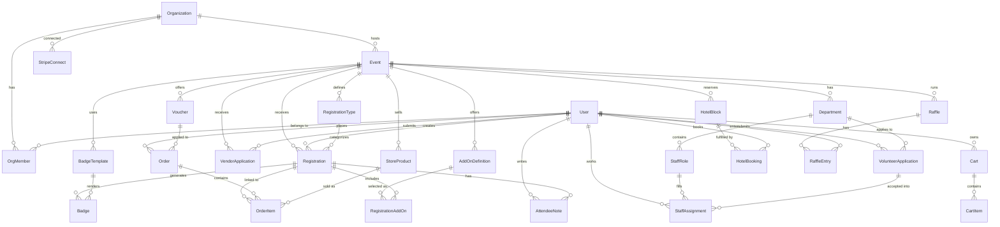

# vFurst — Convention Management SaaS Platform

A full-featured convention/event management SaaS platform inspired by [ConCat](https://concat.app), built with **Next.js App Router** and **Astryx Design System** by Meta.

> [!NOTE]
> **Product Name**: "vFurst" (from the workspace name). This can be changed at any time.
> **Tagline**: "Manage your event, not a spreadsheet."

---

## Decisions (Resolved)

| Question | Decision |
|----------|----------|
| **Multi-tenancy** | **Subdomain-based** — each org gets `{slug}.vfurst.app`. Custom domains (CNAME) added in Phase 6. |
| **Astryx theme** | **`@astryxdesign/theme-neutral`** — clean, professional, muted SaaS aesthetic. |
| **Mobile app** | **React Native companion app** — planned for Phase 5+, covering ticket scanning, check-in, and sales monitoring. |
| **Email provider** | **Dual support**: AWS SES (production scale) + SMTP manual setup (self-hosted/dev). Configurable per-org. |

---

## Revenue Model

Adopted from [convention_saas_roadmap.md](file:///D:/GitHub/vFurst/convention_saas_roadmap.md):

| Trigger | Fee |
|---------|-----|
| Per registered attendee | **$1.00** |
| Per hotel room booked | **$1.00** |
| Store / vendor transactions | **1%** |

Payments processed via **Stripe Connect destination charges** — vFurst creates checkout PaymentIntents on the platform account, sends convention proceeds with `transfer_data.destination`, and collects fees via `application_fee_amount` on each PaymentIntent. Direct charges are not used for the core checkout flow.

> [!IMPORTANT]
> **Fee collection is single-path**: all platform fees are collected at checkout time via Stripe Connect's `application_fee_amount`. There is **no secondary billing job** that invoices conventions separately. The Phase 6 `reconcile-fees.ts` job is **read-only** — it audits that fees were collected correctly, generates usage reports for the billing dashboard, and flags discrepancies, but never charges conventions again.

### Stripe Connect Charge Type

vFurst uses **destination charges** for checkout:

- PaymentIntent / Checkout Session is created by the vFurst platform account.
- Convention proceeds are transferred with `transfer_data.destination = org.stripeAccountId`.
- vFurst fees are collected in the same payment with `application_fee_amount`.
- Direct charges are reserved only for a future exceptional flow that explicitly needs connected-account-owned charges; they are not part of the MVP registration, hotel, store, vendor, or cashier flows.

---

## Phase Comparison: Your Roadmap vs. This Plan

Your [convention_saas_roadmap.md](file:///D:/GitHub/vFurst/convention_saas_roadmap.md) is the authoritative guide. This plan provides the **technical implementation details** for each of your phases.

| Your Phase | Your Focus | What This Plan Adds |
|------------|-----------|-------------------|
| **Phase 0** (Wk 1–3) | Foundation & Planning | Detailed project structure, Prisma schema design, CI/CD config, Astryx setup, subdomain routing architecture |
| **Phase 1** (Wk 4–9) | Core Infrastructure | File-by-file breakdown of auth, RBAC, dashboard shell, Stripe Connect onboarding, email service abstraction layer |
| **Phase 2** (Wk 10–15) | Attendee Registration | Component specs for registration flow, scheduled pricing engine design, Stripe webhook handlers, order model |
| **Phase 3** (Wk 16–19) | Event Store & Add-ons | Unified cart architecture, discount code engine, refund flow via Stripe, inventory management |
| **Phase 4** (Wk 20–25) | Volunteers & Vendors | Volunteer form builder, department hierarchy, shift scheduling UI, dealer approval pipeline, booth management |
| **Phase 5** (Wk 26–30) | Advanced Features | Badge designer canvas architecture, WebUSB printing, express mode, offline fallback (Service Worker), raffle system |
| **Phase 6** (Wk 31–34) | SaaS Layer | Per-attendee billing implementation, usage dashboard, CNAME custom domains, public REST API + webhooks, docs site |
| **Phase 7** (Wk 35–37) | Launch | Beta program playbook, security audit checklist, marketing site, Playwright E2E test suite |

### Key Items Your Roadmap Has That My v1 Was Missing

> [!IMPORTANT]
> These are now fully incorporated:

- ✅ **Revenue model** — per-attendee + per-booking + 1% transaction fees
- ✅ **Stripe Connect** (not just Stripe) — convention orgs get their own Stripe accounts
- ✅ **Phase 6: SaaS Layer** — billing, API keys, webhooks, custom domains, docs site
- ✅ **Phase 7: Launch** — beta program, security audit, load testing, marketing site
- ✅ **Monorepo** — Turborepo for frontend + shared packages
- ✅ **BullMQ + Redis** — background jobs for emails, badge generation, billing
- ✅ **Registration transfers** — attendee-to-attendee transfer flow
- ✅ **Raffle system** — event-based raffle/lottery
- ✅ **Offline fallback** — Service Worker for check-in without connectivity
- ✅ **Custom email template engine** — per-convention customizable templates
- ✅ **User/staff notes** — internal notes on attendee records
- ✅ **Cashier UI** — dedicated in-person registration desk interface
- ✅ **Hotel room booking integration** — with $1.00 per-booking fee
- ✅ **Custom domain (CNAME)** — conventions use their own domain

### Key Items This Plan Has That Your Roadmap Could Benefit From

- 🆕 **Astryx component mapping** — specific UI components for each feature
- 🆕 **File-by-file project structure** — exact file paths and responsibilities
- 🆕 **Data model (ER diagram)** — 29 entities with all relations
- 🆕 **Verification plan** — automated + manual test strategy per phase
- 🆕 **React Native companion app** — mobile scanning/monitoring

---

## Tech Stack

| Layer | Technology | Rationale |
|-------|-----------|-----------|
| **Monorepo** | Turborepo | Shared packages between web, API, mobile |
| **Frontend** | Next.js 15 (App Router) | SSR, API routes, middleware, subdomain routing |
| **UI Library** | Astryx Design System (`@astryxdesign/core`) | 150+ accessible React components, AppShell/SideNav |
| **Theme** | `@astryxdesign/theme-neutral` | Clean, professional SaaS aesthetic with dark mode |
| **Database** | PostgreSQL + Prisma ORM | Relational data, type-safe queries, row-level isolation |
| **Auth** | NextAuth.js v5 (Auth.js) | Multi-provider auth, session management, RBAC |
| **Payments** | Stripe Connect destination charges | Convention Stripe onboarding, `transfer_data.destination`, `application_fee_amount` |
| **File Storage** | Cloudflare R2 | Badge templates, product images, event assets |
| **Email** | AWS SES + SMTP (configurable) | Transactional emails, per-org provider choice |
| **Background Jobs** | BullMQ + Redis | Email queues, badge generation, billing calculations |
| **Validation** | Zod | Schema validation for forms and API |
| **State** | React Server Components + `nuqs` | URL state for filters/search, minimal client state |
| **Charts** | Recharts | Dashboard analytics visualization |
| **Barcode/QR** | `bwip-js` | Badge barcode/QR generation (same lib ConCat uses) |
| **Printing** | WebUSB API | Direct browser-to-Zebra thermal printer |
| **Real-time** | Server-Sent Events | Live check-in counters, dashboard updates |
| **Mobile** | React Native (Expo) | Companion app for scanning + monitoring |
| **CI/CD** | GitHub Actions | Lint, test, build, deploy pipeline |
| **Hosting** | Vercel (web) + Railway (Redis/workers) | Optimized Next.js hosting + background job infra |

---

## Data Model



### Core Entities (29)

| Entity | Key Fields | Purpose |
|--------|-----------|---------|
| **User** | id, email, name, avatar, emailVerified | Platform-wide user account |
| **Organization** | id, name, slug, subdomain, logo, contactEmail, customDomain | Convention organizing body |
| **OrgMember** | userId, orgId, role (OWNER/ADMIN/MEMBER) | Org membership + role |
| **StripeConnect** | orgId, stripeAccountId, onboardingComplete | Stripe Connect account link |
| **Event** | id, orgId, name, slug, startDate, endDate, venue, status, settings | A specific convention instance |
| **RegistrationType** | id, eventId, name, price, maxCapacity, scheduledPricing (JSON) | Attendance tiers (General, VIP, Sponsor) |
| **Registration** | id, eventId, userId, typeId, status, checkedInAt, badgeNumber, transferredFromId | An attendee's event registration |
| **AddOnDefinition** | id, eventId, name, description, price, stock, category, active, metadata | Event-scoped optional add-on catalog item (shirt, meal, workshop, amenity). Target for `RegistrationAddOn.addOnDefId`. |
| **RegistrationAddOn** | id, registrationId, addOnDefId, price, quantity | Optional items on a registration |
| **Badge** | id, registrationId, templateId, barcodeData, nfcTag, printedAt | Physical/digital badge |
| **BadgeTemplate** | id, eventId, name, layout (JSON), dimensions | Badge design template |
| **Department** | id, eventId, name, leadUserId, formSchema (JSON) | Organizational department and its custom volunteer application schema |
| **VolunteerApplication** | id, userId, departmentId, eventId, formResponses (JSON), availability (JSON), status (PENDING/APPROVED/REJECTED), reviewedBy, reviewedAt | Volunteer application with custom form data and approval workflow. Precedes StaffAssignment — approved applications become assignments. |
| **StaffRole** | id, departmentId, roleName, shifts (JSON), maxVolunteers | Staff position definitions |
| **StaffAssignment** | id, userId, roleId, volunteerApplicationId, shiftSlot, status | Volunteer shift assignment (links back to approved application) |
| **VendorApplication** | id, eventId, userId, businessName, status, boothAssignment, assistants (JSON) | Dealer booth application |
| **StoreProduct** | id, eventId, name, price, stock, images, category, surcharges | Merchandise for event store |
| **Cart** | id, userId, eventId, createdAt, updatedAt | Server-side shopping cart (DB-backed, survives device switches and avoids SSR hydration issues) |
| **CartItem** | id, cartId, itemType (REGISTRATION/ADDON/PRODUCT), refId, unitPrice, quantity | Line items in an active cart. Converted to OrderItems on checkout. Cleared after successful payment. |
| **Order** | id, userId, eventId, total, platformFee, status, stripePaymentIntentId, voucherId | Payment + fee record |
| **OrderItem** | id, orderId, itemType, refId, unitPrice, quantity | Line items in a completed order |
| **Voucher** | id, eventId, code, discountType, discountValue, maxUses, usedCount, expiresAt | Promo codes / comped registrations |
| **HotelBlock** | id, eventId, hotelName, roomTypes (JSON), cutoffDate | Hotel room block |
| **HotelBooking** | id, userId, blockId, roomType, checkIn, checkOut, confirmationCode | Hotel room booking |
| **Raffle** | id, eventId, name, prizes (JSON), drawDate | Event raffle/lottery |
| **RaffleEntry** | id, raffleId, userId, entryMethod (AUTO/MANUAL/PURCHASED), createdAt | Individual raffle entry. Prevents duplicates via unique(raffleId, userId) constraint. Used for random draw selection. |
| **AttendeeNote** | id, registrationId, authorId (→ User), content, createdAt | Internal staff notes. `authorId` is a foreign key to User (the staff member writing the note). |
| **ApiKey** | id, orgId, name, keyHash, scopes, lastUsedAt | Public API authentication |
| **WebhookEndpoint** | id, orgId, url, events, secret, active | Outbound webhook config |

---

### JSON Field Contracts

All Prisma `Json` fields must be validated through shared Zod schemas before writes and exported into the OpenAPI contract. These schemas live in `packages/validators/src/json-schemas/` and are imported by API routes, Server Actions, workers, and tests.

| JSON field | Schema file | Purpose |
|------------|-------------|---------|
| `Event.settings` | `event-settings.ts` | Public event behavior, feature flags, check-in settings, and display preferences |
| `RegistrationType.scheduledPricing` | `scheduled-pricing.ts` | Time-windowed price changes with start/end timestamps and fixed prices |
| `BadgeTemplate.layout` | `badge-layout.ts` | Canvas dimensions, layers, fonts, barcode/QR placeholders, and print settings |
| `Department.formSchema` | `department-form.ts` | Custom volunteer application questions per department |
| `VolunteerApplication.formResponses` | `department-form.ts` | Answers keyed by the department form schema's field ids |
| `VolunteerApplication.availability` | `volunteer-availability.ts` | Day/time availability windows and blackout periods |
| `StaffRole.shifts` | `staff-shifts.ts` | Shift slots, required headcount, and schedule metadata |
| `VendorApplication.assistants` | `vendor-assistants.ts` | Assistant names, emails, badge needs, and optional notes |
| `StoreProduct.surcharges` | `store.ts` | Optional product-level surcharge rules for platform-fee calculation |
| `HotelBlock.roomTypes` | `hotel-room-types.ts` | Room names, capacities, nightly prices, and inventory |
| `Raffle.prizes` | `raffle-prizes.ts` | Prize metadata, draw order, and winner assignment shape |
| `WebhookEndpoint.events` | `webhook-events.ts` | Allowed outbound webhook event names and payload versions |

---

## Project Structure (Monorepo)

```
d:\GitHub\vFurst\
├── turbo.json                         # Turborepo config
├── package.json                       # Root workspace config
├── .github/
│   └── workflows/
│       ├── ci.yml                     # Lint + test + type-check
│       └── deploy.yml                 # Production deployment
├── packages/
│   ├── db/                            # Shared Prisma schema + client
│   │   ├── prisma/schema.prisma
│   │   ├── src/client.ts
│   │   └── package.json
│   ├── email/                         # Email service abstraction
│   │   ├── src/
│   │   │   ├── providers/
│   │   │   │   ├── ses.ts             # AWS SES provider
│   │   │   │   └── smtp.ts           # Generic SMTP provider
│   │   │   ├── templates/            # React Email templates
│   │   │   └── index.ts
│   │   └── package.json
│   ├── validators/                    # Shared Zod schemas
│   │   ├── src/
│   │   │   ├── event.ts
│   │   │   ├── registration.ts
│   │   │   ├── vendor.ts
│   │   │   ├── store.ts
│   │   │   └── json-schemas/
│   │   │       ├── scheduled-pricing.ts
│   │   │       ├── event-settings.ts
│   │   │       ├── badge-layout.ts
│   │   │       ├── department-form.ts
│   │   │       ├── volunteer-availability.ts
│   │   │       ├── staff-shifts.ts
│   │   │       ├── vendor-assistants.ts
│   │   │       ├── hotel-room-types.ts
│   │   │       ├── raffle-prizes.ts
│   │   │       └── webhook-events.ts
│   │   └── package.json
│   └── types/                         # Shared TypeScript types + enums
│       ├── src/index.ts
│       └── package.json
├── apps/
│   ├── web/                           # Next.js frontend + API
│   │   ├── next.config.ts
│   │   ├── middleware.ts              # Subdomain routing middleware
│   │   ├── package.json
│   │   ├── public/
│   │   └── src/
│   │       ├── app/
│   │       │   ├── globals.css        # Astryx imports + brand CSS
│   │       │   ├── layout.tsx         # Root layout (Theme provider)
│   │       │   ├── page.tsx           # Marketing landing page
│   │       │   ├── (auth)/            # Auth pages
│   │       │   │   ├── login/page.tsx
│   │       │   │   ├── register/page.tsx
│   │       │   │   └── layout.tsx
│   │       │   ├── (marketing)/       # Marketing pages
│   │       │   │   ├── pricing/page.tsx
│   │       │   │   ├── features/page.tsx
│   │       │   │   └── layout.tsx
│   │       │   ├── (convention)/      # Convention-scoped pages (subdomain)
│   │       │   │   ├── page.tsx               # Convention landing
│   │       │   │   ├── register/page.tsx      # Public registration
│   │       │   │   ├── store/page.tsx         # Public store
│   │       │   │   ├── vendor-apply/page.tsx  # Vendor application
│   │       │   │   └── hotel/page.tsx         # Hotel booking
│   │       │   ├── dashboard/         # Admin dashboard
│   │       │   │   ├── layout.tsx     # AppShell + SideNav
│   │       │   │   ├── page.tsx       # Dashboard home
│   │       │   │   ├── organizations/
│   │       │   │   │   ├── page.tsx
│   │       │   │   │   ├── new/page.tsx
│   │       │   │   │   └── [orgId]/
│   │       │   │   │       ├── page.tsx
│   │       │   │   │       ├── settings/page.tsx
│   │       │   │   │       ├── members/page.tsx
│   │       │   │   │       ├── billing/page.tsx      # Usage + fees
│   │       │   │   │       └── stripe-connect/page.tsx
│   │       │   │   └── events/
│   │       │   │       ├── page.tsx
│   │       │   │       ├── new/page.tsx
│   │       │   │       └── [eventId]/
│   │       │   │           ├── layout.tsx
│   │       │   │           ├── page.tsx              # Overview/stats
│   │       │   │           ├── registrations/
│   │       │   │           │   ├── page.tsx
│   │       │   │           │   ├── types/page.tsx
│   │       │   │           │   ├── transfers/page.tsx
│   │       │   │           │   └── [regId]/page.tsx
│   │       │   │           ├── check-in/
│   │       │   │           │   ├── page.tsx          # Staff check-in
│   │       │   │           │   ├── express/page.tsx  # Express mode
│   │       │   │           │   └── cashier/page.tsx  # In-person desk
│   │       │   │           ├── badges/
│   │       │   │           │   ├── page.tsx
│   │       │   │           │   └── designer/page.tsx
│   │       │   │           ├── staff/
│   │       │   │           │   ├── page.tsx
│   │       │   │           │   ├── departments/page.tsx
│   │       │   │           │   └── schedule/page.tsx
│   │       │   │           ├── vendors/
│   │       │   │           │   ├── page.tsx
│   │       │   │           │   └── booths/page.tsx
│   │       │   │           ├── store/
│   │       │   │           │   ├── page.tsx
│   │       │   │           │   └── orders/page.tsx
│   │       │   │           ├── vouchers/page.tsx
│   │       │   │           ├── raffle/page.tsx
│   │       │   │           ├── hotel/page.tsx
│   │       │   │           ├── analytics/page.tsx
│   │       │   │           └── settings/
│   │       │   │               ├── page.tsx          # General
│   │       │   │               └── emails/page.tsx   # Email templates
│   │       │   └── api/
│   │       │       ├── auth/[...nextauth]/route.ts
│   │       │       ├── webhooks/stripe/route.ts
│   │       │       ├── v1/                           # Public REST API (Phase 6)
│   │       │       │   ├── events/route.ts
│   │       │       │   ├── registrations/route.ts
│   │       │       │   └── attendees/route.ts
│   │       │       └── internal/                     # Internal API routes
│   │       │           ├── check-in/route.ts
│   │       │           ├── badges/route.ts
│   │       │           └── store/route.ts
│   │       ├── components/
│   │       │   ├── providers.tsx
│   │       │   ├── dashboard/
│   │       │   │   ├── app-shell.tsx
│   │       │   │   ├── event-nav.tsx
│   │       │   │   ├── stat-card.tsx
│   │       │   │   └── data-table.tsx
│   │       │   ├── forms/
│   │       │   │   ├── registration-form.tsx
│   │       │   │   ├── event-form.tsx
│   │       │   │   ├── volunteer-form-builder.tsx
│   │       │   │   └── vendor-application-form.tsx
│   │       │   ├── badges/
│   │       │   │   ├── badge-preview.tsx
│   │       │   │   ├── badge-designer.tsx
│   │       │   │   └── print-manager.tsx
│   │       │   ├── check-in/
│   │       │   │   ├── scanner.tsx
│   │       │   │   ├── check-in-station.tsx
│   │       │   │   └── cashier-ui.tsx
│   │       │   ├── store/
│   │       │   │   ├── product-card.tsx
│   │       │   │   └── cart.tsx
│   │       │   └── marketing/
│   │       │       ├── hero.tsx
│   │       │       ├── feature-showcase.tsx
│   │       │       └── pricing-cards.tsx
│   │       ├── lib/
│   │       │   ├── auth.ts
│   │       │   ├── stripe-connect.ts
│   │       │   ├── storage.ts
│   │       │   ├── barcode.ts
│   │       │   ├── webusb-printer.ts
│   │       │   ├── subdomain.ts         # Subdomain resolution helpers
│   │       │   └── offline-sync.ts      # Service Worker helpers
│   │       ├── actions/                 # Server Actions
│   │       │   ├── auth-actions.ts
│   │       │   ├── event-actions.ts
│   │       │   ├── registration-actions.ts
│   │       │   ├── check-in-actions.ts
│   │       │   ├── vendor-actions.ts
│   │       │   ├── store-actions.ts
│   │       │   ├── voucher-actions.ts
│   │       │   ├── transfer-actions.ts
│   │       │   └── raffle-actions.ts
│   │       └── sw/                      # Service Worker source compiled by @serwist/next
│   │           └── offline-checkin.ts
│   └── worker/                          # Background job processor
│       ├── package.json
│       ├── tsconfig.json
│       ├── src/
│       │   ├── index.ts               # BullMQ worker entry
│       │   ├── jobs/
│       │   │   ├── send-email.ts
│       │   │   ├── generate-badges.ts
│       │   │   ├── reconcile-fees.ts    # Read-only audit, NOT billing
│       │   │   └── sync-stripe.ts
│       │   └── queues.ts
```

---

## Phased Implementation (Aligned to Your Roadmap)

### Phase 0 — Foundation & Planning (Weeks 1–3)

> **Goal**: Monorepo scaffold, database schema, CI/CD, dev environment, and architectural decisions locked in.

| Task | Files / Actions |
|------|----------------|
| Define MVP feature scope | This document ✅ |
| Database schema design | [NEW] `packages/db/prisma/schema.prisma` — all 29 entities, enums, indexes, row-level tenant isolation via `orgId` |
| JSON field contract design | [NEW] `packages/validators/src/json-schemas/` — Zod schemas for every Prisma `Json` field (`scheduledPricing`, `formSchema`, badge layout, staff shifts, webhook events, etc.) |
| API contract design | [NEW] `docs/api-contracts/` — OpenAPI spec for REST endpoints + webhook event schemas generated from shared validators |
| Set up monorepo | [NEW] `turbo.json`, root `package.json` with workspaces: `apps/*`, `packages/*` |
| Scaffold worker app | [NEW] `apps/worker/package.json`, `apps/worker/tsconfig.json`, `apps/worker/src/index.ts`, `apps/worker/src/queues.ts` — BullMQ process shell used by later email, badge, Stripe sync, and fee reconciliation jobs |
| CI/CD pipeline | [NEW] `.github/workflows/ci.yml` — lint, type-check, test, build on PR |
| | [NEW] `.github/workflows/deploy.yml` — Vercel preview + production deploys |
| Dev / staging / prod envs | [NEW] `.env.example`, `.env.local`, `.env.staging` — env var templates |
| Stripe Connect setup | Create Stripe Connect platform account, configure OAuth redirect URIs |
| Choose and configure hosting | Vercel project creation, Railway Redis instance, Cloudflare R2 bucket |
| Initialize Next.js + Astryx | [NEW] `apps/web/` — Next.js 15 app with Astryx imports in `globals.css` |
| | [NEW] `apps/web/src/app/layout.tsx` — Root layout with `Theme` provider |
| | [NEW] `apps/web/src/components/providers.tsx` — Client providers wrapper |

---

### Phase 1 — Core Infrastructure (Weeks 4–9)

> **Goal**: Multi-tenant architecture, auth, RBAC, convention CRUD, Stripe Connect onboarding, dashboard shell, email service, and subdomain routing.

---

#### Multi-Tenancy & Subdomain Routing

##### [NEW] `apps/web/middleware.ts`
Next.js middleware for subdomain-based routing:
- Parse `{slug}.vfurst.app` from `Host` header
- Rewrite to `/(convention)` route group with org context
- Pass-through for `app.vfurst.app` (dashboard) and `vfurst.app` (marketing)
- Handle custom domains (Phase 6) via database lookup

##### [NEW] `apps/web/src/lib/subdomain.ts`
Subdomain resolution helpers:
- `resolveOrganization(hostname)` — lookup org by subdomain or custom domain
- `getConventionUrl(org)` — generate subdomain URL for an org

---

#### Auth & RBAC

##### [NEW] `apps/web/src/lib/auth.ts`
NextAuth v5 configuration:
- Credentials provider (email/password with bcrypt)
- Google OAuth provider
- Prisma adapter for session persistence
- Custom session callback to include `orgMemberships` with roles
- JWT strategy for API route authentication

##### [NEW] `apps/web/src/app/(auth)/login/page.tsx`
Login page using Astryx `Card`, `TextInput`, `Button`, `FormLayout`, `Divider`.

##### [NEW] `apps/web/src/app/(auth)/register/page.tsx`
Registration page with email/password + OAuth buttons.

##### [NEW] `apps/web/src/app/(auth)/layout.tsx`
Centered auth layout — no AppShell, minimal branding.

---

#### Convention CRUD

##### [NEW] `apps/web/src/app/dashboard/organizations/page.tsx`
Org list using Astryx `Table`, `EmptyState`, `Button`.

##### [NEW] `apps/web/src/app/dashboard/organizations/new/page.tsx`
Create org form: name, slug (auto-generated, editable), logo upload, contact email.

##### [NEW] `apps/web/src/app/dashboard/organizations/[orgId]/page.tsx`
Org overview: member list, events list, quick stats.

##### [NEW] `apps/web/src/app/dashboard/organizations/[orgId]/settings/page.tsx`
Org settings: name, logo, subdomain slug, email provider config (SES vs SMTP).

##### [NEW] `apps/web/src/app/dashboard/organizations/[orgId]/members/page.tsx`
Member management: invite by email, assign roles (OWNER/ADMIN/MEMBER), remove.

##### [NEW] `apps/web/src/app/dashboard/organizations/[orgId]/stripe-connect/page.tsx`
Stripe Connect onboarding:
- OAuth flow to connect convention's Stripe account
- Account status dashboard
- Test mode toggle

##### [NEW] `apps/web/src/actions/event-actions.ts`
Server Actions: `createEvent`, `updateEvent`, `publishEvent`, `archiveEvent`, `deleteEvent`.

---

#### Dashboard Shell

##### [NEW] `apps/web/src/app/dashboard/layout.tsx`
Dashboard layout using Astryx `AppShell` with collapsible `SideNav`:
```
├── Dashboard (home)
├── Organizations
├── Events
├── Settings
└── [User Avatar] Profile / Logout
```

##### [NEW] `apps/web/src/app/dashboard/page.tsx`
Dashboard home: recent events, quick stats (total attendees, revenue), quick action buttons.

##### [NEW] `apps/web/src/components/dashboard/app-shell.tsx`
Reusable AppShell wrapper with navigation state management.

##### [NEW] `apps/web/src/components/dashboard/stat-card.tsx`
Metric card component using Astryx `Card`, `Heading`, `Text`, `ProgressBar`.

---

#### Email Service

##### [NEW] `packages/email/src/providers/ses.ts`
AWS SES email provider using `@aws-sdk/client-ses`.

##### [NEW] `packages/email/src/providers/smtp.ts`
Generic SMTP provider using `nodemailer` — for self-hosted/custom SMTP servers.

##### [NEW] `packages/email/src/index.ts`
Email service abstraction:
- Factory pattern: `createEmailProvider(config)` returns SES or SMTP instance
- Unified `sendEmail(to, template, data)` interface
- Per-org provider configuration stored in org settings

##### [NEW] `packages/email/src/templates/`
React Email templates: welcome, registration confirmation, password reset.

---

### Phase 2 — Attendee Registration & Hotel Booking (Weeks 10–15)

> **Goal**: Product system, attendance tiers, scheduled pricing, public registration flow, Stripe payments, order management, tier upgrades, add-ons, confirmation emails, **and hotel room booking**.

---

##### [NEW] `apps/web/src/app/dashboard/events/page.tsx`
Events list with filters using Astryx `PowerSearch`, `Table`, `Badge` for status.

##### [NEW] `apps/web/src/app/dashboard/events/new/page.tsx`
Event creation wizard (multi-step using Astryx `SegmentedControl`):
1. Basic info (name, dates, venue, description)
2. Registration types + pricing tiers
3. Settings (payment, capacity, visibility)
4. Review & publish

##### [NEW] `apps/web/src/app/dashboard/events/[eventId]/layout.tsx`
Event-scoped layout with contextual `SideNav`:
```
├── Overview
├── Registrations
│   ├── All Registrations
│   ├── Registration Types
│   └── Transfers
├── Check-In
├── Badges
├── Staff
│   ├── Overview
│   ├── Departments
│   ├── Applications      ← VolunteerApplication management
│   └── Schedule
├── Vendors
├── Store
├── Hotel
├── Vouchers
├── Raffle
├── Analytics
└── Settings
```

##### [NEW] `apps/web/src/app/dashboard/events/[eventId]/page.tsx`
Event overview dashboard with Recharts:
- Registration count trend (area chart)
- Revenue summary (stat cards)
- Capacity by tier (progress bars)
- Recent registrations feed

##### [NEW] `apps/web/src/app/dashboard/events/[eventId]/registrations/types/page.tsx`
Registration type management:
- CRUD for attendance tiers
- **Scheduled pricing engine**: define price changes by date range (early bird → regular → late)
- Capacity limits per tier
- Add-on definitions per tier (complimentary + paid)
- Drag-to-reorder display order

##### [NEW] `apps/web/src/app/(convention)/register/page.tsx`
Public registration flow (on convention subdomain):
1. Select tier → shows scheduled price
2. Personal info form
3. Add-ons selection
4. Apply voucher/discount code
5. Stripe Checkout (Stripe Connect destination charge, with `transfer_data.destination` and `application_fee_amount: 100` = $1.00)
6. Confirmation page + email

##### [NEW] `apps/web/src/app/api/webhooks/stripe/route.ts`
Stripe webhook handler:
- `checkout.session.completed` → confirm registration, send confirmation email
- `payment_intent.succeeded` → mark order paid
- `charge.refunded` → update order + registration status

##### [NEW] `apps/web/src/app/dashboard/events/[eventId]/registrations/page.tsx`
Registrations table:
- Search/filter by name, email, status, type
- Bulk actions (confirm, cancel, refund)
- Export to CSV
- Click-through to detail

##### [NEW] `apps/web/src/app/dashboard/events/[eventId]/registrations/[regId]/page.tsx`
Registration detail:
- Attendee info, payment status, badge preview
- Check-in status, add-ons
- **Staff notes** (`AttendeeNote` CRUD)
- Actions: resend email, cancel, refund, upgrade tier
- **Registration transfer**: initiate transfer to another user

##### [NEW] `apps/web/src/actions/registration-actions.ts`
Server Actions: `createRegistration`, `confirmRegistration`, `cancelRegistration`, `refundRegistration`, `upgradeTier`, `transferRegistration`.

---

#### Hotel Booking (Phase 2)

> [!NOTE]
> Hotel booking is built here in Phase 2 (not deferred) because it shares the registration flow's Stripe Connect payment pipeline and the $1.00 `application_fee_amount` pattern. Building it alongside registration avoids duplicating payment logic later.

##### [NEW] `apps/web/src/app/dashboard/events/[eventId]/hotel/page.tsx`
Hotel management (admin):
- Create hotel blocks: hotel name, room types (single/double/suite), rates, block size, cutoff date
- View booking status per block (booked vs. available)
- Manage individual bookings (cancel, modify dates)

##### [NEW] `apps/web/src/app/(convention)/hotel/page.tsx`
Public hotel booking page (convention subdomain):
- Browse available hotel blocks and room types
- Select dates, room type
- Stripe Checkout as a Stripe Connect destination charge with `application_fee_amount: 100` ($1.00 per booking)
- Confirmation email with booking details

##### [NEW] `apps/web/src/actions/hotel-actions.ts`
Server Actions: `createHotelBlock`, `updateHotelBlock`, `bookRoom`, `cancelBooking`.

---

### Phase 3 — Event Store & Add-ons (Weeks 16–19)

> **Goal**: Product catalog, inventory, surcharges, discount engine, vouchers/comps, unified cart, refunds.

---

##### [NEW] `apps/web/src/app/dashboard/events/[eventId]/store/page.tsx`
Product management:
- Product CRUD: name, price, description, images (R2 upload), stock, category
- **Surcharges**: configurable per-product surcharges (shipping, handling)
- Product add-ons (e.g., size selection, color)
- Inventory tracking with low-stock alerts

##### [NEW] `apps/web/src/app/(convention)/store/page.tsx`
Public storefront (convention subdomain):
- Product grid with Astryx `Card`, image gallery
- **Unified cart**: combine registration + store items in one checkout
- Stripe Checkout as a Stripe Connect destination charge with 1% `application_fee_amount`

##### [NEW] `apps/web/src/components/store/cart.tsx`
Shopping cart component:
- **Server-side cart** backed by `Cart` + `CartItem` database tables (not localStorage)
- Cart loaded via Server Component on page render — no SSR/hydration mismatch
- Mutations via Server Actions (`addToCart`, `removeFromCart`, `updateQuantity`)
- Works across devices (user logs in → same cart), survives incognito/storage clears
- Discount code application
- Real-time total calculation with surcharges
- Cart → Order conversion on successful Stripe Checkout (CartItems become OrderItems, cart is cleared)

> [!NOTE]
> **Why not localStorage?** Next.js App Router renders on the server first. A localStorage-based cart would render empty on the server, then hydrate with items on the client, causing a React hydration mismatch error. A DB-backed cart also enables cross-device persistence and unified cart features (registration + store in one checkout).

##### [NEW] `apps/web/src/app/dashboard/events/[eventId]/vouchers/page.tsx`
Voucher management:
- Create: percentage discount, flat discount, or **comped registration** (100% off)
- Usage limits, expiration dates, tier restrictions
- **Bulk generate**: create N codes with shared rules
- Usage tracking table

##### [NEW] `apps/web/src/app/dashboard/events/[eventId]/store/orders/page.tsx`
Order management:
- Order list with status filters
- Order detail with line items + platform fee breakdown
- **Refund flow**: full or partial refund via Stripe Connect

##### [NEW] `apps/web/src/actions/store-actions.ts`
Server Actions: `createProduct`, `updateProduct`, `deleteProduct`, `createOrder`, `refundOrder`, `partialRefund`.

##### [NEW] `apps/web/src/actions/voucher-actions.ts`
Server Actions: `createVoucher`, `bulkGenerateVouchers`, `validateVoucher`, `applyVoucher`.

---

### Phase 4 — Volunteers & Vendors (Weeks 20–25)

> **Goal**: Volunteer application builder, department management, approval workflows, dealer applications, booth/table management, assistants.

---

#### Volunteer System

##### [NEW] `apps/web/src/app/dashboard/events/[eventId]/staff/page.tsx`
Staff overview: department list, total volunteers, unfilled shifts, pending applications count.

##### [NEW] `apps/web/src/app/dashboard/events/[eventId]/staff/departments/page.tsx`
Department management:
- Create departments (Registration, Security, Panels, AV, etc.)
- Assign department leads
- **Form builder**: configure custom volunteer application questions per department (stored as JSON schema on Department)

##### [NEW] `apps/web/src/app/dashboard/events/[eventId]/staff/applications/page.tsx`
Volunteer application management:
- Applications list with status filters (PENDING/APPROVED/REJECTED)
- Review individual applications: view form responses, availability, preferences
- Approve → creates `StaffAssignment` linked to the `VolunteerApplication`
- Reject with optional reason (sent via email)
- Bulk approve/reject

##### [NEW] `apps/web/src/app/(convention)/volunteer/page.tsx`
Public volunteer application form (convention subdomain):
- Renders dynamic form fields from department's JSON schema
- Availability calendar picker (which days/shifts the volunteer is available)
- Department preference selection (1st/2nd/3rd choice)
- Creates a `VolunteerApplication` record with status PENDING

##### [NEW] `apps/web/src/app/dashboard/events/[eventId]/staff/schedule/page.tsx`
Shift schedule:
- Calendar/grid view of shifts by department
- Drag-and-drop volunteer assignment
- **Availability matching**: auto-suggest based on volunteer's `VolunteerApplication.availability`
- Conflict detection (double-booking)
- **Mass email**: email all volunteers in a department

##### [NEW] `apps/web/src/components/forms/volunteer-form-builder.tsx`
Dynamic form builder for volunteer applications:
- Drag-and-drop field types (text, select, checkbox, textarea)
- Required/optional toggle
- Preview mode
- Outputs JSON schema stored on `Department.formSchema`

##### [NEW] `apps/web/src/actions/staff-actions.ts`
Server Actions: `submitVolunteerApplication`, `approveApplication`, `rejectApplication`, `assignShift`, `removeAssignment`.

---

#### Vendor/Dealer System

##### [NEW] `apps/web/src/app/dashboard/events/[eventId]/vendors/page.tsx`
Vendor application management:
- Application list with status (PENDING/APPROVED/REJECTED/WAITLISTED)
- Bulk approve/reject
- Application detail: business info, product description, uploaded files
- **Dealer assistants**: view/manage listed assistants per vendor

##### [NEW] `apps/web/src/app/dashboard/events/[eventId]/vendors/booths/page.tsx`
Booth/table management:
- Booth layout grid/map
- **Table type + amenity products**: define table sizes with different prices + optional amenities
- Assign vendors to booths
- Track booth status (available, assigned, paid)

##### [NEW] `apps/web/src/app/(convention)/vendor-apply/page.tsx`
Public vendor application (convention subdomain):
- Business info, product description
- Table type selection + amenity add-ons
- **Dealer assistants**: add assistant names + badges
- **Seating preferences**: neighbor/location preferences
- File uploads (product photos, business license)
- Payment for booth upon approval

##### [NEW] `apps/web/src/actions/vendor-actions.ts`
Server Actions: `submitApplication`, `approveVendor`, `rejectVendor`, `waitlistVendor`, `assignBooth`, `addAssistant`.

---

### Phase 5 — Advanced Features (Weeks 26–30)

> **Goal**: Badge designer, print queue, cashier UI, express check-in, offline fallback, registration transfers, raffle system, custom email templates, staff notes.

---

##### [NEW] `apps/web/src/app/dashboard/events/[eventId]/badges/designer/page.tsx`
Visual badge template designer:
- **Canvas-based** drag-and-drop editor (HTML5 Canvas or Fabric.js)
- Add: text fields, images, barcodes, QR codes, attendee data placeholders
- Layer management (z-order)
- Preview with sample registration data
- Save/load templates, set as default for registration types

##### [NEW] `apps/web/src/app/dashboard/events/[eventId]/badges/page.tsx`
Badge management:
- Batch generate badges for all confirmed registrations
- Print queue (sorted by registration order)
- Reprint individual badges
- Print statistics

##### [NEW] `apps/web/src/lib/webusb-printer.ts`
WebUSB thermal printer driver (inspired by ConCat's [WebZLP](https://github.com/ConventionCatCorp/WebZLP)):
- Detect connected Zebra LP-series printers via WebUSB
- Send ZPL (Zebra Programming Language) commands
- Print queue with status tracking

##### [NEW] `apps/web/src/app/dashboard/events/[eventId]/check-in/page.tsx`
**Staff check-in station**:
- Search registrations by name, email, badge number, order id, or QR payload
- Scan QR/barcode using camera or USB scanner input
- Show paid/unpaid, badge status, notes, and duplicate check-in warnings
- Trigger badge reprint and cashier handoff when payment is missing
- Registers the offline service worker via `useServiceWorker()`

##### [NEW] `apps/web/src/app/dashboard/events/[eventId]/check-in/cashier/page.tsx`
**Cashier UI** — dedicated in-person registration desk:
- Walk-in registration flow (create + pay + print badge in one flow)
- Cash/card toggle
- Badge print on completion
- Optimized for speed (keyboard shortcuts)

##### [NEW] `apps/web/src/app/dashboard/events/[eventId]/check-in/express/page.tsx`
**Express Mode**:
- Self-service kiosk interface
- Attendee scans own QR code (from confirmation email)
- Auto-verify identity
- Auto-print badge via WebUSB
- No staff intervention needed

##### Service Worker: Offline Check-In

> [!IMPORTANT]
> **Service Workers must be served from a public URL.** Next.js only serves static files from `public/`. A `.ts` file in `src/workers/` would never be compiled or reachable by `navigator.serviceWorker.register()`, causing silent runtime failure.

The offline check-in system uses **3 files**:

##### [NEW] `apps/web/next.config.ts` (MODIFY)
Add `@serwist/next` plugin to the Next.js config. This compiles the SW source from `src/sw/` and outputs the compiled JS to `public/sw.js` at build time:
```ts
import withSerwist from '@serwist/next';
export default withSerwist({
  swSrc: 'src/sw/offline-checkin.ts',  // Source (TypeScript)
  swDest: 'public/sw.js',              // Output (served at /sw.js)
})({ /* existing next config */ });
```

##### [NEW] `apps/web/src/sw/offline-checkin.ts`
The Service Worker **source** (compiled to `public/sw.js` by `@serwist/next`):
- Uses Serwist's `BackgroundSyncQueue` to queue check-in API calls when offline
- Caches the check-in page shell + attendee lookup data for offline access
- On reconnect: drains the queue and syncs all queued check-ins to the server
- This file is TypeScript and gets compiled — it is NOT served directly

##### [NEW] `apps/web/src/hooks/use-service-worker.ts`
Client-side registration hook (used in check-in pages):
```ts
'use client';
import { useEffect } from 'react';
export function useServiceWorker() {
  useEffect(() => {
    if ('serviceWorker' in navigator) {
      navigator.serviceWorker.register('/sw.js'); // ← serves from public/
    }
  }, []);
}
```
The check-in and express mode pages call `useServiceWorker()` to register the compiled SW.

**Offline fallback behavior:**
- Cache check-in page + attendee data for offline use
- Queue check-ins locally (IndexedDB via Serwist BackgroundSyncQueue) when offline
- Sync to server when connectivity restored
- Visual indicator for offline mode (banner component reads `navigator.onLine`)

##### [NEW] `apps/web/src/app/dashboard/events/[eventId]/registrations/transfers/page.tsx`
**Registration transfer flow**:
- Initiator requests transfer, enters recipient email
- Recipient receives email with accept/decline link
- On accept: registration ownership transfers, new badge generated
- Admin can view/approve/deny transfers

##### [NEW] `apps/web/src/app/dashboard/events/[eventId]/raffle/page.tsx`
**Raffle system**:
- Create raffle: name, prizes, draw date, eligibility rules
- Entry methods (auto-enter on registration, manual entry, ticket purchase)
- Random draw with winner notification
- Winner history

##### [NEW] `apps/web/src/app/dashboard/events/[eventId]/settings/emails/page.tsx`
**Custom email template engine**:
- Edit templates for: registration confirmation, payment receipt, volunteer approval, vendor status, transfer request
- Variable placeholders (`{{attendee.name}}`, `{{event.name}}`, etc.)
- Preview with sample data
- HTML + plain text versions

---

### Phase 6 — SaaS Layer (Weeks 31–34)

> **Goal**: Per-attendee billing, usage dashboard, custom domains, public API, webhooks, documentation, rate limiting.

---

##### [NEW] `apps/web/src/app/dashboard/organizations/[orgId]/billing/page.tsx`
**Usage dashboard** for convention organizers:
- Per-attendee fee breakdown ($1.00 × N attendees)
- Per-booking fee breakdown ($1.00 × N hotel bookings)
- Transaction fee breakdown (1% × store/vendor revenue)
- Monthly usage report history
- Connected-account fee collection status

##### [NEW] `apps/web/src/app/dashboard/events/[eventId]/analytics/page.tsx`
**Event analytics dashboard**:
- Registration funnel, ticket mix, revenue, and check-in throughput
- Store/vendor/hotel revenue summaries using already-collected Stripe Connect fees
- Volunteer and vendor application status charts
- Exportable CSV reports for organizers

##### [NEW] `apps/worker/src/jobs/reconcile-fees.ts`
**Fee reconciliation** (read-only audit job, NOT a billing job):
- Nightly job: aggregate all `application_fee_amount` values collected via Stripe Connect for each org
- Compare against expected fees (count of registrations × $1.00, hotel bookings × $1.00, store revenue × 1%)
- Generate usage reports for the billing dashboard (breakdown by fee type)
- **Flag discrepancies** (e.g., comped registrations that bypassed Stripe, failed webhooks)
- Does NOT create charges or invoices — all fees are already collected at checkout via `application_fee_amount`

> [!IMPORTANT]
> **No double billing**: Platform fees are collected once, at checkout time, via Stripe Connect's `application_fee_amount`. This job only audits and reports — it never charges conventions. The billing dashboard in `[orgId]/billing/page.tsx` reads from this job's reports.

##### [NEW] `apps/web/middleware.ts` (MODIFY)
**Custom domain (CNAME) support**:
- Database lookup for custom domains
- Verify domain ownership via DNS TXT record
- SSL handled by Vercel/Cloudflare

##### [NEW] `apps/web/src/app/dashboard/organizations/[orgId]/settings/page.tsx` (MODIFY)
Add custom domain configuration:
- Enter custom domain
- Show DNS records to configure (CNAME + TXT verification)
- Verify button
- Status indicator

##### [NEW] `apps/web/src/app/api/v1/`
**Public REST API**:
- API key authentication (Bearer token)
- Rate limiting (100 req/min default)
- Endpoints: events, registrations, attendees, vendors, store, badges
- Pagination, filtering, sorting
- OpenAPI spec auto-generation

##### [NEW] `packages/db/prisma/schema.prisma` (MODIFY)
Add `ApiKey` and `WebhookEndpoint` models.

##### [NEW] `apps/web/src/app/dashboard/organizations/[orgId]/api-keys/page.tsx`
API key management: create, revoke, set scopes.

##### [NEW] `apps/web/src/app/dashboard/organizations/[orgId]/webhooks/page.tsx`
**Webhook event system**:
- Configure webhook endpoints (URL + secret)
- Select events to subscribe to (`registration.created`, `registration.checked_in`, `order.paid`, etc.)
- Delivery logs with retry
- Test webhook button

##### [NEW] Documentation site
Docusaurus-based docs site (separate from main app, or embedded under `/docs`):
- Getting started guide
- API reference (auto-generated from OpenAPI)
- Webhook event catalog
- Convention onboarding checklist

---

### Phase 7 — Launch (Weeks 35–37)

> **Goal**: Beta program, security audit, performance testing, legal pages, marketing site, public launch.

---

##### Beta program with 2–3 real conventions
- Recruit beta conventions, offer free/discounted usage
- Collect feedback, iterate on UX pain points
- Monitor production errors (Sentry integration)

##### Performance & load testing
- Artillery or k6 load tests on registration + check-in flows
- Target: 1000 concurrent registrations, 500 concurrent check-ins
- Database query optimization (indexes, connection pooling)

##### Security audit
- OWASP Top 10 review
- SQL injection prevention (Prisma handles this)
- XSS prevention (React handles this)
- CSRF protection (NextAuth handles this)
- Rate limiting on auth + payment endpoints
- Input validation (Zod on all endpoints)

##### PCI compliance
- Stripe handles all card data (SAQ A compliance)
- No card numbers stored in vFurst database
- Stripe Connect ensures convention funds are properly segregated

##### Accessibility audit
- WCAG 2.1 AA compliance
- Astryx components are accessible out of the box
- Screen reader testing on key flows

##### [NEW] Legal pages
- `apps/web/src/app/(marketing)/privacy/page.tsx` — Privacy Policy
- `apps/web/src/app/(marketing)/terms/page.tsx` — Terms of Service
- `apps/web/src/app/(marketing)/dmca/page.tsx` — DMCA Takedown Policy

##### [NEW] Marketing site
- `apps/web/src/app/page.tsx` — Landing page: hero, features, pricing, testimonials
- `apps/web/src/app/(marketing)/pricing/page.tsx` — Pricing page with fee calculator
- `apps/web/src/app/(marketing)/features/page.tsx` — Feature deep-dives

##### [NEW] Playwright E2E test suite
```bash
# Critical path tests
npx playwright test --project=chromium
```
- Registration flow (end-to-end with Stripe test mode)
- Check-in flow
- Vendor application flow
- Admin CRUD operations

---

## Verification Plan

### Automated Tests (Per Phase)

```bash
# Unit + integration tests (Vitest)
npm run test

# E2E tests (Playwright)
npm run test:e2e

# Type checking across monorepo
turbo run type-check

# Linting across monorepo
turbo run lint

# Database schema validation
cd packages/db && npx prisma validate

# Full build check
turbo run build
```

### Manual Verification Checkpoints

| Phase | Verification |
|-------|-------------|
| **0** | Monorepo builds, Prisma schema validates, CI pipeline green, dev env runs |
| **1** | Login/register works, dashboard renders, org CRUD works, Stripe Connect onboarding completes, subdomain routing resolves |
| **2** | Create event → configure tiers → publish → register as attendee → pay → see in admin → receive email; Create hotel block → book room → verify $1.00 fee collected |
| **3** | Add store products → purchase as attendee → unified cart works → voucher applies → refund processes |
| **4** | Submit volunteer application → admin reviews form responses → approve → assign shift (VolunteerApplication → StaffAssignment); Apply as vendor → approve → assign booth → booth payment |
| **5** | Design badge → print test badge → express check-in with QR → offline check-in works → raffle draw |
| **6** | API key works → API returns data → webhook fires → custom domain resolves → usage report generates → fee discrepancies are flagged |
| **7** | Load test passes → security audit clean → E2E suite green → marketing site live → beta conventions onboarded |

---

## Timeline Summary

| Phase | Focus | Duration |
|-------|-------|----------|
| Phase 0 | Foundation & Planning | 3 weeks |
| Phase 1 | Core Infrastructure | 6 weeks |
| Phase 2 | Attendee Registration | 6 weeks |
| Phase 3 | Event Store & Add-ons | 4 weeks |
| Phase 4 | Volunteers & Vendors | 6 weeks |
| Phase 5 | Advanced Features | 5 weeks |
| Phase 6 | SaaS Layer | 4 weeks |
| Phase 7 | Launch | 3 weeks |
| **Total** | | **~37 weeks** |

> **Solo developer:** ~8–9 months.
> **Team of 3:** ~4–5 months.

---

## Key Astryx Components by Feature Area

| Feature Area | Astryx Components |
|-------------|-------------------|
| **Dashboard Shell** | `AppShell`, `SideNav`, `Breadcrumbs` |
| **Data Tables** | `Table`, `PowerSearch`, `Pagination`, `Badge`, `DropdownMenu` |
| **Forms** | `FormLayout`, `TextInput`, `Selector`, `DateInput`, `DateTimeInput`, `NumberInput`, `Switch`, `TextArea`, `FileInput`, `Field`, `Tokenizer`, `RadioList`, `CheckboxInput` |
| **Cards & Stats** | `Card`, `ClickableCard`, `SelectableCard`, `Heading`, `Text`, `ProgressBar` |
| **Overlays** | `Dialog`, `Popover`, `Toast`, `Tooltip` |
| **Navigation** | `SideNav`, `Breadcrumbs`, `SegmentedControl`, `Pagination`, `Outline` |
| **Feedback** | `Banner`, `Spinner`, `Skeleton`, `StatusDot`, `EmptyState` |
| **Buttons/Actions** | `Button`, `ButtonGroup`, `IconButton`, `MoreMenu`, `Toolbar`, `ToggleButton` |
| **Layout** | `Stack`, `VStack`, `HStack`, `Grid`, `Section`, `Divider`, `AspectRatio` |
| **Content** | `Avatar`, `AvatarGroup`, `Timestamp`, `Token`, `Code`, `Markdown` |
| **Check-in/Kiosk** | `Calendar`, `Slider` (for raffle), `Carousel` (for badge preview) |
